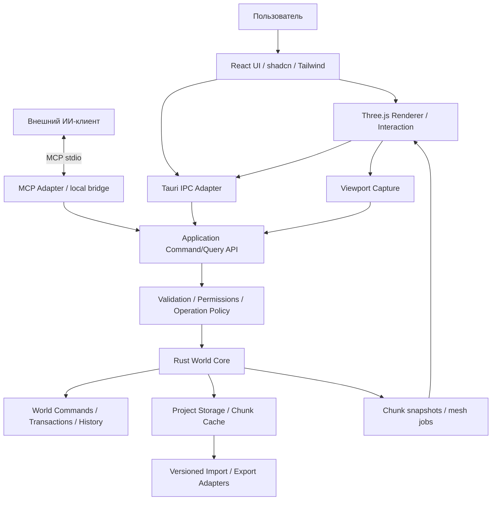
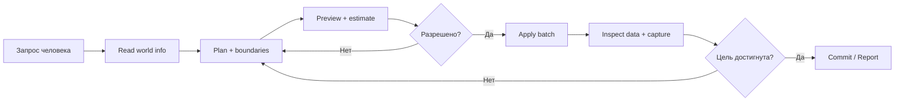

# FuryBuilder — Product Vision & Engineering Blueprint

> **Статус:** концепция + архитектурный план + дорожная карта (living document).  
> **Дата:** 16 ноября 2026 года.  
> **Обновлено:** 17 ноября 2026 года — объектный слой, Build DSL, Observation/Validation, MCP 2026-07-28, матрица форматов, режимы создания мира, автоматическое обнаружение игровых ассетов и управляемая Java/server-зависимость.  
> **Тип:** единый документ для владельца проекта, разработчиков и ИИ-агентов.  
> **Целевая платформа:** самостоятельное desktop-приложение; **Windows first**, затем macOS/Linux при наличии тестирования.  
> **Игра:** Minecraft **Java Edition**; основной редактор работает без запуска игры. Только режим **Vanilla World** использует оригинальный генератор выбранной Java-версии через отдельный локальный процесс (без игрового окна).  
> **Приоритет:** корректность данных → безопасность изменений → работающий редактор → AI/MCP → масштабирование и дополнительные возможности.

**Обозначения:**
- **Зафиксировано** — решение, уже выбранное для проекта.
- **Предложение** — рекомендуемое решение, которое можно пересмотреть после прототипа.
- **Отложено** — не входит в первую работоспособную версию.
- `[ ]` — задача ещё не выполнена; чекбоксы отмечаются **только после проверки критерия готовности**.

---

## Содержание

- [1. Идея и цель](#1-идея-и-цель)
- [2. Границы проекта и приоритеты](#2-границы-проекта-и-приоритеты)
- [3. Технологический стек](#3-технологический-стек)
- [4. Архитектура: модульная монолитная система](#4-архитектура-модульная-монолитная-система)
- [5. Модель мира и проекта](#5-модель-мира-и-проекта)
- [6. Three.js: 3D-сцена, отображение и управление](#6-threejs-3d-сцена-отображение-и-управление)
- [7. Редактирование, генерация, семантика](#7-редактирование-генерация-семантика)
- [8. ИИ-интеграция и MCP](#8-ии-интеграция-и-mcp)
- [9. Minecraft Java: совместимость, импорт и экспорт](#9-minecraft-java-совместимость-импорт-и-экспорт)
- [10. UX/UI: редактор, а не демонстрация](#10-uxui-редактор-а-не-демонстрация)
- [11. Производительность и память](#11-производительность-и-память)
- [12. Безопасность, приватность и надёжность](#12-безопасность-приватность-и-надёжность)
- [13. Тестирование и критерии корректности](#13-тестирование-и-критерии-корректности)
- [14. Репозиторий, инструменты и процессы](#14-репозиторий-инструменты-и-процессы)
- [15. Дорожная карта с задачами и критериями готовности](#15-дорожная-карта-с-задачами-и-критериями-готовности)
- [16. Порядок релизных вертикальных срезов](#16-порядок-релизных-вертикальных-срезов)
- [17. Риски и стратегия снижения](#17-риски-и-стратегия-снижения)
- [18. Решения, требующие отдельного утверждения (ADR / Open Questions)](#18-решения-требующие-отдельного-утверждения-adr-open-questions)
- [19. Backlog идей для будущего развития (не обещания MVP)](#19-backlog-идей-для-будущего-развития-не-обещания-mvp)
- [20. Правила для ИИ-разработчика, который будет реализовывать проект](#20-правила-для-ии-разработчика-который-будет-реализовывать-проект)
- [21. Контрольные пользовательские сценарии к первой beta](#21-контрольные-пользовательские-сценарии-к-первой-beta)
- [22. Исследованные источники и технические ориентиры](#22-исследованные-источники-и-технические-ориентиры)
- [23. Краткий итог и следующий шаг](#23-краткий-итог-и-следующий-шаг)

---

## 1. Идея и цель

**FuryBuilder** — современная, независимая от запущенной игры 3D-студия для создания, просмотра, редактирования и подготовки миров Minecraft Java Edition. Пользователь работает с территориями любого разумного масштаба: от маленькой постройки или схематики до городов, регионов и полноценных миров. Это **не игровой клиент и не очередной набор команд WorldEdit**, а единая творческая среда, объединяющая визуальный редактор, систему проектов и инструменты для ИИ.

**Главное отличие — AI-first, но не AI-only.** Все возможности доступны человеку через интерфейс, а внешним ИИ-агентам — через структурированный API и MCP. Агент должен уметь не просто «поставить блок», но и **понять мир → спланировать задачу → получить контекст → безопасно внести изменения → визуально и структурно проверить → исправить результат**. Пользователь сохраняет контроль над проектом, операциями и экспортом.

### 1.1 Примеры пользовательских сценариев

1. **Empty Project:** создать полностью пустое пространство или плоскую основу, построить крепость, при необходимости добавить локальный рельеф и экспортировать локацию как структуру либо валидный Java-мир.
2. **Vanilla World:** выбрать точную версию Minecraft Java, параметры генерации и seed; получить участки мира посредством **оригинального генератора Minecraft**, затем редактировать их в FuryBuilder.
3. **Import World:** импортировать существующий Java-мир, найти деревню, выделить территорию, обновить архитектуру, сохранить исходник нетронутым.
3. **ИИ-строительство:** «Построй средневековый портовый город 300×300 блоков: набережная, склад, рынок, дороги. Делай по этапам и проверяй результат».
5. **ИИ-редактирование:** «Сохрани планировку улиц, но замени стиль зданий на японский; сначала покажи план изменений».
6. **Подготовка к серверу:** экспортировать валидный мир/структуру в поддерживаемом формате и версии, проверить совместимость с целевым сервером.
7. **Совместная работа:** вручную нарисовать границы района, поручить агенту застройку внутри них, затем поправить детали кистями.

### 1.2 Принципы продукта

- **Offline-first:** базовое строительство, просмотр и экспорт работают локально; облако и модель ИИ необязательны. Загрузка игровых ассетов, Java и серверного JAR — **только по необходимости, с уведомлением и явным согласием пользователя**; скачанное кэшируется для последующей офлайн-работы.
- **Один источник истины:** изменяемый мир хранится в независимом ядре, а не в объектах Three.js или React state.
- **Неразрушающее редактирование:** оригиналы не переписываются без явного решения пользователя; изменения можно просмотреть и отменить.
- **Честность представления:** 3D-превью максимально похоже на Minecraft, но **не притворяется полным игровым симулятором** (например, тики, редстоун, свет, генерация чанков и поведение сущностей могут отличаться).
- **Равные инструменты:** интерфейс, автоматизация и MCP используют общий слой операций и проверок.
- **Масштабируемость:** весь мир не должен одновременно находиться в RAM и GPU.
- **Контролируемая автоматизация:** агент видит ограничения, стоимость операций, прогресс, ошибки и ревизии проекта.
- **Совместимость по версии:** версия данных мира и поддерживаемые возможности всегда указаны явно. Seed не обещает vanilla-совпадения в пустом проекте или при использовании процедурных инструментов — оно относится только к явно выбранному режиму `Vanilla World`.
- **Расширяемость:** новые инструменты, форматы и алгоритмы не должны требовать переписывания ядра.
- **Два уровня редактирования:** реальные Minecraft-блоки плюс необязательные параметрические объекты (дома, дороги, генераторы); их связь должна быть явной и обратимой.
- **Наблюдаемость и проверяемость:** ИИ получает структурные карты/диффы и результаты валидаторов, а не только красивые скриншоты.

---

## 2. Границы проекта и приоритеты

### 2.1 MVP (первый действительно полезный редактор)

- Создание **Empty Project** (пустое 3D-пространство или плоская основа) с **конкретной зафиксированной версией Minecraft Java**; исходный Java-мир не нужен.
- Корректное представление блоков и их состояний, чанков, секций, координат и измерений (в рамках объявленной поддержки).
- 3D-камера, обзор, выбор блока, добавление/удаление, кисть, выделение и массовые операции.
- Чанковый рендер без отдельного `Mesh` на каждый блок; загрузка ближайших чанков по требованию.
- Сохранение/восстановление проекта, undo/redo, безопасный экспорт хотя бы **одного проверенного формата**.
- Минимальный API операций, через который одинаково работают UI и MCP.
- MCP: чтение контекста, запрос области, предпросмотр, пакетная правка, снимок экрана, отмена/проверка состояния.
- Отчёт об экспорте, читаемые ошибки и тесты на реальных фикстурах.

**Критически важно:** «MVP редактора» и «полная совместимость с произвольным существующим миром» — **разные цели**. Сначала можно качественно освоить собственный мир и один формат структур; импорт/обратный экспорт полных сохранений включать только после доказанного round-trip.

### 2.2 После MVP

- **Vanilla World:** создание Java-мира по seed через **оригинальный локальный Minecraft Java worldgen** выбранной версии с подтверждёнными настройками, ограничением генерируемой области и последующим редактированием; не собственная имитация vanilla.
- **Import World:** полноценный read/write для поддерживаемых Java-миров, пакетный импорт и экспорт.
- **Локальные процедурные инструменты:** создание/правка отдельных гор, рек, островов, пещер, лесов, дорог и объектов внутри любого режима, а не альтернативная генерация целого случайного мира.
- Интеллектуальная семантическая карта мира (здания, дороги, районы, ориентиры).
- Референсы: изображения, схемы, карты высот, примеры построек.
- Пошаговые AI-проекты с оценкой результата и повторными итерациями.
- Параметрические объекты поверх блоков и ограниченный Build DSL для высокоуровневых строительных заданий.
- Режимы инспекции для ИИ: карты высот/материалов/биомов, сечения, сравнение ревизий и автоматическая валидация.
- Автоматическое обнаружение законно установленных игровых ассетов по выбранной Java-версии, ручной выбор `client.jar`/папки установки, пользовательские resource packs; управление источниками текстур без обязательной установки Minecraft для `Empty Project`.
- Управление зависимостями режима `Vanilla World`: поиск совместимой Java, при необходимости загрузка локального Eclipse Temurin и официального `server.jar` по выбранной версии, проверка целостности и кэш; без глобальной установки Java и без скрытого согласия с EULA.
- Пакеты текстур/resource packs, библиотека шаблонов, генерация вариантов.
- Плагины, скрипты, дополнительные форматы, совместные/удалённые рабочие процессы.

### 2.3 Не входит в начальный объём

- Полный игровой движок Minecraft, физика и тики/редстоун 1:1.
- Гарантированная поддержка **всех** версий Java, всех модов, любых кастомных измерений и data packs.
- Bedrock Edition и автоматическая миграция всех миров между платформами.
- Онлайн-мультиплеер, хостинг серверов, маркетплейс, облачное хранение.
- Собственный генератор случайного **полноценного мира**, который при том же seed выдаёт иной результат, чем Minecraft. Не пытаться воссоздать vanilla worldgen вручную; использование оригинального генератора — отдельный этап.
- Мгновенная генерация «бесконечного» мира: в Vanilla World генерировать/подгружать выбранные чанки по запросу или ограниченной области, а не весь мир сразу.
- Выдача лицензированных игровых текстур или кода Minecraft внутри дистрибутива без отдельной правовой проверки.

---

## 3. Технологический стек

| Область | Решение | Статус | Почему |
|---|---|---|---|
| Desktop-оболочка | **Tauri 2** | **Зафиксировано** | Нативное приложение и связка WebView ↔ Rust |
| UI | **React + TypeScript + Vite** | **Зафиксировано** | Сложные панели, IDE-подобный интерфейс, быстрые итерации |
| Стили | **Tailwind CSS v4** | **Зафиксировано** | Дизайн-система и utility-first |
| UI-компоненты | **shadcn/ui** | **Зафиксировано** | Контролируемый код компонентов и удобная кастомизация |
| 3D | **Three.js** | **Зафиксировано** | Геометрия чанков, камеры, сцена, raycasting, кастомные материалы |
| World Core | **Rust** | **Предложение / настоятельно рекомендовано** | Хранение и преобразование мира, операции, undo/redo, форматы |
| Состояние UI | Zustand + локальное состояние React | **Предложение** | Панели, выбор инструментов, настройки; **не** хранение всего мира |
| Валидация контрактов | TypeScript schema validation (например, Zod) + Rust Serde | **Предложение** | Согласованные данные между слоями |
| Локальные настройки/метаданные | Tauri Store или SQLite по потребности | **Предложение** | Настройки, каталог проектов; SQLite **не** для каждого блока |
| MCP | Протокол MCP + поддерживаемый SDK/адаптер | **Предложение** | Подключение внешних AI-клиентов; транспорт отдельно от API мира |
| 3D-рендерер | Three.js `WebGLRenderer` (WebGL 2) сначала | **Предложение** | Самый предсказуемый первый путь; WebGPU оценить позже |
| Управление пакетами | pnpm; Cargo/rustup | **Предложение** | Удобные lock-файлы и воспроизводимые сборки |
| Тестирование | Vitest, React Testing Library, Playwright при возможности, `cargo test` | **Предложение** | UI, контракты, ядро, форматы, end-to-end |

**Не внедрять всё сразу.** Для первого этапа достаточно React/Vite/Tauri/Rust/Three.js/Tailwind/shadcn; остальное добавлять под измеримую необходимость. Не использовать React Three Fiber как обязательный фундамент воксельной сцены: высокочастотное обновление больших мешей удобнее держать в отдельном императивном модуле Three.js. R3F можно рассмотреть позднее для небольших сцен/оверлеев, но это не должно менять модель мира.

### 3.1 Особенности десктопа

- Windows: WebView2 и MSVC Build Tools для разработки; проверить GPU/WebGL на целевом оборудовании.
- macOS/Linux: нативные WebView отличаются — тестировать рендер, обработку файлов и упаковку отдельно.
- Браузерная версия **в перспективе**, но не в MVP. Её подготовка — независимые Rust-крейты, абстрактные порты хранения и API операций, отсутствие Tauri-зависимостей в доменной логике.

---

## 4. Архитектура: модульная монолитная система

**Рекомендация:** начинать с **modular monolith** в одном репозитории. Никаких микросервисов, распределённых очередей, Kubernetes и обязательного облака.



**Потоки:**

1. UI создаёт команду (`set_block`, `fill`, `paste`, `undo`), но **не меняет модель мира напрямую**.
2. Команда проходит валидацию, проверку ограничений и применение транзакцией в Rust Core.
3. Core увеличивает `world_revision`, записывает журнал изменений и выдаёт список `dirty_chunks`/события.
4. Рендерер запрашивает обновлённые данные затронутых секций/чанков, перестраивает только нужные меши.
5. MCP вызывает **тот же Application API**, а не пишет в `.mca` и не манипулирует DOM/Canvas.
6. Импорт/экспорт пользуется явным адаптером версии и отчётом о сохранённых/неподдерживаемых данных.

### 4.1 Модули и ответственность

| Модуль | Отвечает за | Не должен делать |
|---|---|---|
| `world-domain` (Rust) | Измерения, координаты, блоки, состояния, секции, чанки, ревизии | Зависеть от React/Tauri/Three |
| `world-operations` (Rust) | Выделение, кисти, fill/replace, paste, undo/redo, транзакции | Работать с 3D-мешами |
| `world-io` (Rust) | Чтение/запись форматов, версии, NBT/Anvil, совместимость | Незаметно терять неизвестные теги |
| `world-generation` (Rust) | Локальные процедурные инструменты для отдельных областей и объектов + независимый адаптер к оригинальному Java worldgen | Подменять vanilla-режим своим noise-генератором или смешивать seed двух режимов |
| `asset-source` (Rust + renderer adapter) | Поиск локальных игровых ассетов, проверка версии, разрешение resource packs, отдача валидированных ресурсов рендереру, кэш | Публиковать оригинальные Minecraft-ассеты с FuryBuilder или подменять block states отсутствующей текстурой |
| `runtime-manager` (Rust + Tauri service) | Обнаружение Java, подтверждённая загрузка и контроль целостности Temurin/`server.jar`, изолированный запуск worldgen и управление версиями/кэшем | Устанавливать Java глобально, принимать EULA за пользователя или оставлять открытый серверный порт |
| `world-application` (Rust) | Команды, query, работа с проектами, права, задачи | Хранить весь UI-state |
| `renderer` (TS + Three.js) | Меши, материалы, камеры, pick, видимость, скриншоты | Быть источником истины для блоков |
| `editor-ui` (React) | Рабочее пространство, панели, настройки, инструменты | Сериализовать Java-мир самостоятельно |
| `desktop-adapter` (Tauri) | Окна, нативные диалоги, IPC, системные интеграции | Реализовывать игровую бизнес-логику |
| `mcp-adapter` | Набор доступных AI-инструментов, ресурсы, протокол | Обходить валидацию и историю операций |

### 4.2 Слои и границы API

- **Commands** — меняют состояние и возвращают `operation_id`, `world_revision`, количество затронутых блоков/чанков и предупреждения.
- **Queries** — читают состояние с `world_revision`, поддерживают ограничения области, фильтры и пагинацию.
- **Jobs** — длительные операции с `job_id`, прогрессом, отменой, статусом и явной фиксацией результата.
- **Events/stream** — invalidation, обновление чанков и прогресс; для частого упорядоченного потока данных использовать **Tauri Channels**, для коротких запросов — команды.
- **Render snapshots** — оптимизированная передача нужных воксельных секций/меш-данных; не пересылать гигантские JSON-массивы блоков на каждый кадр.

**Правило:** контракты между TypeScript и Rust нужно версионировать. Генерировать типы из общего описания (или проверять контрактными тестами), не держать две расходящиеся копии типов.

---

## 5. Модель мира и проекта

### 5.1 Внутренняя модель

Минимально необходимые сущности:

- `Project`: идентификатор, название, `project_schema_version`, **`creation_mode` (`empty` / `vanilla` / `import`)**, `target_minecraft_version`, сведения об источнике, состояние сохранения.
- `World`: измерения, metadata, границы созданных/загруженных областей. Для `vanilla` — исходный seed, точная версия, preset/worldgen-настройки, datapacks и статус генерации; для `import` — данные оригинального мира; для `empty` — пустые разреженные чанки или явно созданная плоская основа. Seed отдельного процедурного инструмента хранить в операции/рецепте, а не выдавать за seed Java-мира.
- `Dimension`: идентификатор (`minecraft:overworld` и т. п.), диапазон Y, окружение и настройки.
- `Chunk`: координаты `(cx, cz)`, секции и связанные игровые данные; логика ленивой загрузки.
- `Section`: 16×16×16 блоков, **палитра + упакованные индексы**, эффективное представление пустоты.
- `BlockState`: **namespaced ID + свойства** (`minecraft:oak_stairs[facing=north,half=bottom,...]`), а не только строковое имя блока или числовой ID.
- `Biome`, `BlockEntity`, `Entity`, `Ticks`, `Heightmap`, `Lighting`, `POI` и прочие данные — по мере заявленной поддержки, с возможностью сохранения нетронутых неизвестных полей.
- `Selection`, `Structure/Clipboard`, `SemanticObject` (дом, дорога, район), `ParametricObject` (параметры/генератор/версия), `Operation`, `Revision`.

**Координаты:** мир — целочисленные `(x, y, z)`. Чанк 16×16 по X/Z, секция 16³, регион `.mca` — 32×32 чанка. Отрицательные координаты вычислять через **floor division**, а не обычное усечение к нулю. Реальный доступный Y и структура папок зависят от версии и измерения; не хардкодить высоту 256/384 и не предполагать, что все папки мира одинаковы во всех версиях.

### 5.2 Формат проекта (предложение)

На начальном этапе проект — **папка**, а не один монолитный бинарный файл: легче восстанавливать, инспектировать и тестировать.

```text
MyCastle.furybuilder/
├── project.json              # схема проекта, target version, provenance
├── source/                   # оригинальные импортированные файлы (read-only копии)
├── data/                     # внутреннее хранилище чанков/структур (версионируемое)
├── changes/                  # журнал транзакций, checkpoints, undo metadata
├── assets/                   # пользовательские разрешённые ресурсы/референсы
├── previews/                 # thumbnails и согласованные снимки
└── cache/                    # пересоздаваемые меши/временные артефакты
```

В `project.json` обязательно различать режим проекта (`empty`/`vanilla`/`import`), версию целевой Java и происхождение мира; для `vanilla` фиксировать seed, настройки, datapacks и идентичность использованного генератора, для `import` — неизменяемый источник. Конкретные имена и бинарная схема — **не утверждённый файловый стандарт**; должны быть формализованы перед реализацией. Кэш можно удалять; `data/` и `changes/` нельзя. `project.json` описывает версию схемы и имеет автоматические миграции с резервной копией.

**Для импортированных миров:** исходные байты хранить отдельно и неизменно; над ними применять overlay/изменения. При экспорте по возможности использовать passthrough нетронутых регионов/тегов, а изменённые сериализовать через адаптер версии. Это уменьшает риск потери несвязанных игровых данных. **Сохранение неизвестных полей проверяется round-trip-тестами** — простая загрузка их в типизированные структуры недостаточна.

### 5.3 Конкурентное редактирование и транзакции

- Единственный авторитетный процесс World Core для открытого проекта; UI и MCP — клиенты.
- `world_revision` повышается на каждую принятую транзакцию; команда может указать `expected_revision`.
- Атомарность операции: либо применены все допустимые изменения, либо ничего; для очень больших работ — явно обозначенные checkpoints и частичные результаты.
- `undo/redo` строится на обратимых диффах/снимках изменённых секций с ограничением диска; не копировать целиком мир на каждую операцию.
- Возможность preview/dry-run, подсчёта затронутых блоков, запрета операций за границами разрешённой области.
- Не позволять экспортировать незавершённую/неконсистентную транзакцию.

---

### 5.4 Объектный слой (Scene Graph) и Voxel Cache — после MVP

**Задача:** сохранить удобство Minecraft-блоков, но дать возможность двигать, поворачивать и перенастраивать целый дом, дорогу или генератор как один объект. **Это не замена модели мира.** Для редактирования импортированных Java-миров первичными остаются block states в `world-domain`; для созданных в FuryBuilder параметрических объектов первичны их **параметры и рецепт генерации**, которые компилируются в детерминированные изменения блоков.

- **Semantic/Scene Graph:** объекты с `object_id`, типом, границами, трансформацией, параметрами, зависимостями и версией генератора; связи «район → улица → здание» — метаданные проекта, а не Minecraft NBT.
- **Voxel overlay:** материализованный результат объекта в чанках; после изменения параметров пересчитывать **только затронутые области**. Кеш 3D-мешей отдельно производный и полностью пересоздаваемый.
- **Редактирование вручную:** чёткая политика конфликта — блок изменён поверх параметрического объекта → пользователь выбирает `override`, `detach/bake` или пересборку. Нельзя молча уничтожать ручные правки.
- **Границы и совместимость:** при экспорте в `.schem`, `.nbt` или Java-мир объект **запекается в блоки**; внутренние параметры, иерархия, ограничения и история остаются в проекте FuryBuilder, не обещаются в стороннем формате.
- **История:** операции над объектами и полученные voxel-diffs проходят через общий Command/Query API, preview, permissions, revision и undo/redo. Импортированный обычный дом **не становится** автоматически корректным параметрическим объектом без явного распознавания или ручной разметки.

**Критерий качества:** параметрический дом можно переместить/изменить/отменить без потери неотносящихся блоков, а экспорт сохраняет ожидаемые block states.

---

## 6. Three.js: 3D-сцена, отображение и управление

### 6.1 Рендеринг

- **Не использовать отдельный `THREE.Mesh` для каждого блока.** Генерировать меши секций/чанков с отбросом невидимых граней, а затем профилировать greedy meshing.
- Отдельно учитывать opaque, cutout и translucent геометрию; прозрачность, воду, листву, некубические модели, соседние грани.
- Использовать `BufferGeometry`, атласы/пакеты текстур или подходящую материальную систему; повторно использовать материалы и управлять их `dispose()`.
- `InstancedMesh` применять там, где множество одинаковых объектов и реальный выигрыш; это **не замена** chunk meshing для всех блоков.
- Chunk streaming, view/frustum culling, радиус прогрузки, приоритет рядом с камерой, LRU-кэш CPU/GPU.
- Перестраивать затронутые секции и соседние границы при изменениях; избегать полного пересоздания сцены.
- Пакетные изменения геометрии выполнять с бюджетом времени; тяжёлые вычисления — в Rust workers или Web Workers по профилю.
- Большие мировые координаты: local origin/перебазирование вокруг камеры для точности `float32` в GPU; глобальные координаты хранить как целые.
- Следить за жизненным циклом GPU-ресурсов, контекстом WebGL и восстановлением при ошибке.

### 6.2 Камера и инструменты

- Свободная 3D-камера: orbit/fly, WASD, панорамирование, изменение скорости, переход к координатам.
- Поиск блока/позиции, raycasting и точное определение грани; выделение чанка, области, слоя, объекта.
- Сетка, оси, координаты, границы чанков, слои, clipping/срезы, hide/show, wireframe/debug.
- Режимы: выделение, одиночный блок, кисть, линия, коробка, fill, replace, перемещение/копирование структуры.
- Предпросмотр кисти/вставки «призраком» до фиксации; подсказки клавиатуры.
- Простые и надёжные текстуры/модели в MVP; точное воспроизведение всех состояний блоков — отдельный трек.

### 6.3 Скриншоты для ИИ

`capture_viewport` — **настоящий рендер кадра**, а не текстовое «описание». Запрос принимает камеру/позицию/угол/разрешение/режим слоёв; ответ возвращает изображение, параметры камеры, охват, `world_revision`, предупреждения о незагруженных чанках и статус готовности мешей.

Для корректной оценки: сначала дождаться необходимых чанков и обновления мешей (или явно вернуть `partial=true`), затем создать изображение. Если окно свёрнуто, обычный захват Canvas может быть недоступен; headless/offscreen renderer следует выделять отдельной задачей, а не обещать невидимую автоматическую съёмку с первого дня.

**Обязательно разделять:** визуальную оценку по скриншоту и точную инспекцию по координатам/палитрам. ИИ должен пользоваться обоими способами.

---

### 6.4 Режимы Observation для ИИ — развивать после первого `capture_viewport`

В дополнение к обычному рендеру сделать **воспроизводимые пространственные наблюдения**, основанные на конкретной ревизии мира:

| Режим | Что возвращает / зачем нужен |
|---|---|
| `beauty` / `viewport` | Обычный вид с заданной камерой для человека и vision-модели |
| `top_down` | Ортографическая карта сверху для дорог, кварталов и планировки |
| `heightmap` | Карта высот/поверхностей для рельефа и поиска перепадов |
| `material_map` / `biome_map` | Цветовая классификация материалов или биомов для аудита палитры |
| `cross_section` / `slice` | Срез по плоскости/высоте для помещений, пещер и скрытых блоков |
| `revision_diff` | Добавленные/удалённые/изменённые блоки между двумя ревизиями |

Запрос должен явно задавать `project_id`, dimension, bounds/камеру, режим, resolution, `world_revision`. В ответе — изображение **и** метаданные: легенда, координаты, масштаб, полнота загруженных данных, предупреждения, статус `partial`. Не подменять точные block queries цветной картой. Для регрессионных тестов использовать фиксированные параметры/ресурсы и детерминированные снимки; отличия WebView/GPU учитывать отдельно.

---

## 7. Редактирование, генерация, семантика

### 7.1 Общий Operation API

Операции не должны зависеть от источника вызова:

- `set_block`, `set_blocks_batch`, `get_block`, `get_region_summary`.
- `fill_cuboid`, `replace`, `paint_surface`, `erase`, `line`, `sphere`, `cylinder`.
- `copy_region`, `paste_structure`, `rotate`, `mirror`, `move`, `undo`, `redo`.
- `select_region`, `get_selection`, `get_chunk_stats`, `find_blocks`.
- `generate_heightmap`, `smooth_terrain`, `generate_vegetation` — после MVP.

**Крупные задачи** должны выражаться как **пакеты/области**, а не миллионы одиночных RPC-вызовов.

### 7.2 Описание операции (концептуальный пример, не обещание готового API)

```json
{
  "type": "fill_cuboid",
  "project_id": "project-001",
  "dimension": "minecraft:overworld",
  "bounds": { "min": [10, 64, 10], "max": [30, 68, 30] },
  "block_state": { "name": "minecraft:stone_bricks", "properties": {} },
  "expected_revision": 42,
  "mode": "preview",
  "idempotency_key": "unique-request-key"
}
```

Порядок: **validate → estimate → preview → approve (по политике) → apply transaction → revision → invalidate meshes → verify**.

**Ограничения API:** явные inclusive/exclusive границы, допустимые размеры, квоты на число блоков, seed детерминированности, отмена, ошибки без немых пропусков, `idempotency_key` для защиты от повторного применения, фиксация `actor` и `operation_id`.

### 7.3 Режимы создания проекта и генерация мира

**Принятое продуктовое решение — три режима, без четвёртого «случайного мира FuryBuilder»:**

| Режим | Что видит пользователь | Источник блоков/рельефа | Этап |
|---|---|---|---|
| **Empty Project** | Полностью пустое 3D-пространство либо необязательная плоская основа; ручная/AI-сборка без готового Java-мира | Внутренняя разреженная блочная модель, локальные команды и генераторы объектов | **MVP** |
| **Vanilla World** | Настоящий Minecraft Java-мир, созданный по указанному seed, версии и настройкам генерации | **Оригинальный worldgen Minecraft Java** через контролируемый локальный Java-процесс, не самописный аналог | **После MVP (M9)** |
| **Import World** | Существующий мир из папки сохранения, открытый для безопасной правки | Прочитанные и сохранённые данные оригинального Java-мира с copy-on-write overlay | **После MVP (M8)** |

**Правила Vanilla World:**

1. Пользователь задаёт **точную версию Java, seed, preset/world type, включённые структуры и поддерживаемые datapacks/настройки**; для совпадения с оригиналом требуется одинаковая конфигурация. Один seed без версии и настроек **недостаточен**. Цель — получить мир, сгенерированный настоящим механизмом выбранного релиза, а не воспроизвести его приближённым Rust-noise. Не гарантировать поблочное совпадение при отличиях порядка генерации чанков или других параметров; проверять на эталонных мирах.
2. **Не реализовывать самостоятельный порт vanilla worldgen.** Использовать отдельный Java-bridge/локальный оригинальный серверный движок с генерацией выбранной области/чанков и последующим чтением файлов через `world-io`. Режим не требует **запуска игрового окна**. По умолчанию FuryBuilder сначала ищет совместимую Java и законно полученный серверный JAR в локальном кэше/указанном пользователем пути, затем **предлагает** загрузить недостающие зависимости (см. §9.7). Условия Minecraft EULA принимает **сам пользователь**; не включать игровой сервер или Minecraft-ассеты в open-source-дистрибутив без разрешения.
3. Генерировать чанки **лениво или ограниченными партиями** по заданным координатам, показывать прогресс/ошибки, поддерживать отмену и изоляцию временных файлов. Генерация при просмотре не должна молча перезаписывать пользовательские правки; отделить «сгенерированную основу» от overlay FuryBuilder.
4. Экспорт полного Vanilla World — **валидная папка Java-мира**, включая связанные файлы/метаданные, не просто `.mca`; после редактирования проверять итог в Minecraft выбранной версии. Если оригинальный движок не доступен или версия не поддержана — сообщить об этом, не заменять его тихо другим генератором.

**Локальная генерация — это инструменты строительства, а не отдельный тип мира:** `generate_mountain`, `create_island`, `carve_cave`, `generate_road`, размещение деревьев/структур, heightmap/noise/erosion и параметры Build DSL. Они доступны в **любом режиме**, работают внутри выбранной области и могут иметь собственный `seed`, `generator_version` и настройки для повторяемости. Этот seed **не обещает** совпадения с ландшафтом vanilla Minecraft.

**Empty Project** хранит только реально созданные чанки и метаданные; перед экспортом **в структуру** выбирают bounds/offset, а при экспорте **в полный мир** создают валидные Java-метаданные и решают, что происходит с ещё не созданными чанками (void/заполнение/vanilla generation по отдельному явному выбору). Не экспортировать «пустой набор блоков» под видом готового мира без валидного `level.dat` и настроек генератора.

**Import World** сохраняет оригинальную конфигурацию генерации и неизвестные данные там, где это поддержано; новые чанки не генерируются самописным генератором FuryBuilder. Все три режима разделяют **один World Core, Operation API, undo/redo, MCP, рендер, структуру проекта и систему экспорта**.

### 7.4 Семантическая карта для AI

Поверх блоков можно вести необязательный слой метаданных: `district`, `building`, `road`, `entrance`, `landmark`, `style`, `owner`, `protected_region`. Это **метаданные редактора**, не автоматически распознаваемые Minecraft. Связывать их с координатами и ревизиями; разрешать ручную корректировку и отмечать степень уверенности автоматического распознавания.

Так ИИ сможет отвечать не только «что в X,Y,Z?», но и «где северные ворота?» или «какие здания относятся к торговому району?». Не обещать семантическое понимание без индексации и проверяемых данных.

---
### 7.5 Build DSL — высокоуровневый язык строительства (после базовых операций)

**Идея:** дать ИИ описывать намерение **компактно и декларативно**, без тысяч одиночных `set_block`. Первая реализация — **типизированная JSON/AST-схема поверх общего Operation API**, а не самостоятельный небезопасный интерпретатор.

```json
{
  "kind": "house",
  "at": [120, 64, -40],
  "size": [12, 8, 9],
  "style": "nordic",
  "roof": "gable",
  "palette": { "wall": "minecraft:spruce_planks", "roof": "minecraft:dark_oak_stairs" },
  "seed": 42
}
```

- `DSL input → schema validation → resolve versioned blocks → deterministic generator → preview/diff → policy/approval → world transaction`.
- Рецепты/генераторы имеют версию, входные параметры, границы, предельный бюджет блоков, диагностические сообщения; одинаковые входные данные дают одинаковый результат в рамках версии генератора.
- Поддерживать композицию (дом → квартал), шаблоны, параметры и повторное применение; при генерации правильно поворачивать `BlockState` (лестницы, двери и т. п.), а не только геометрию.
- **Не выполнять произвольный JavaScript/Python/код, присланный ИИ.** Скриптовая песочница, если потребуется, — отдельное решение с разрешениями и квотами.
- DSL **дополняет**, но не заменяет ручные команды и точные block-level операции; возможности несуществующих генераторов не объявлять доступными в MCP.

### 7.6 Validation / Critic — проверка качества постройки

Добавить проверяемые, объяснимые валидаторы: опора и подозрительные «парящие» блоки, непрерывность дорожек и проходов, выход за разрешённые границы, ориентация block states, неподходящая палитра, конфликт с защищёнными зонами, экспортная совместимость. Для освещения/безопасности спавна/проходимости **различать приближённую эвристику и проверку реальной Minecraft-логикой** — это не полноценная игровая симуляция.

Каждая находка — структурированный `finding`: `rule_id`, `severity`, координаты/область, объяснение, `world_revision`, степень уверенности и предлагаемое исправление. Снимки и vision-критика служат **дополнительным** сигналом; изменения после отчёта проходят preview/approval и общую транзакционную систему. Не разрешать агенту бесконечно «исправлять» одно и то же без бюджета попыток.

---

## 8. ИИ-интеграция и MCP

### 8.1 Модель взаимодействия

**Платформа — MCP server/provider инструментов**, а внешнее приложение с ИИ (OpenCode, Claude Desktop, другое MCP-совместимое окружение) — MCP client. Встроенный AI-чат **необязателен** и может появиться позже. Сам MCP **не является моделью ИИ** и не гарантирует планирование — он обеспечивает безопасный и описанный доступ к функциям редактора.

**Рекомендованный первый путь:** локальный MCP **stdio** адаптер, который по авторизованному локальному IPC связывается с запущенным ядром/экземпляром проекта. Тогда AI-клиент запускает небольшой stdio-процесс, а тот вызывает те же операции, что и Tauri UI. Это позволяет подключаться без облака и не открывать внешний порт. Если реализация MCP на Rust не соответствует выбранной версии протокола, допустим **тонкий TypeScript MCP sidecar** на актуальном официальном SDK; доменная логика остаётся в Rust.

**Альтернатива позже:** Streamable HTTP только на loopback с проверкой origin/host, явной авторизацией и минимальным сетевым доступом; удалённая публикация — отдельный security-review. По состоянию на дату документа актуальная версия спецификации MCP — **2026-07-28**: она развивает stateless-подход, поэтому не следует проектировать API так, будто **состояние проекта или разговора** магически привязано к транспортному соединению. Использовать явные `project_id`, `job_id`, `world_revision`, `selection_id`, `snapshot_id` и другие идентификаторы контекста.

### 8.2 Инструменты MCP: минимальный и расширенный набор

**Discovery / чтение (MVP):**

| Tool | Назначение |
|---|---|
| `project_list` / `project_open` | Найти или открыть проект с явным выбором и разрешениями |
| `world_info` | Версия, измерения, границы, ревизия, размер, статус загрузки |
| `list_blocks` / `get_block` | Валидные block states и точечное чтение |
| `inspect_region` | Сводка территории: палитра, пустоты, материалы, отметки |
| `get_chunk_status` | Загружен ли чанк, известны ли данные, есть ли ошибки |
| `get_camera` / `set_camera` | Управление точкой обзора в разрешённом редакторе |
| `capture_viewport` | Изображение с контекстом камеры и ревизии |

**Изменение (MVP):**

| Tool | Назначение |
|---|---|
| `preview_operation` | Оценка влияния и объёма изменений до записи |
| `apply_operation` | Применить одну типизированную обратимую операцию |
| `apply_operations_batch` | Атомарная или явно поэтапная пакетная правка |
| `undo_operation` | Отменить свою или явно выбранную обратимую транзакцию |
| `get_operation_status` | Результат/ошибки/прогресс по `operation_id`/`job_id` |
| `export_preview` | Проверить готовность к экспорту, без неявной записи файла |

**Расширенные после MVP:** `find_structure`, `get_heightmap`, `set_biome`, `generate_terrain`, `place_structure`, `get_semantic_map`, `compare_revisions`, `validate_export`, `run_batch_plan`, `read_reference_image`, `get_available_assets`.

### 8.3 MCP Resources и Prompts

- **Resources:** схемы доступных блоков для выбранной версии, описание инструментов, ограничения проекта, прочитанные безопасные сводки, статус работы; большие данные — пагинировать и ограничивать.
- **Prompts/templates:** «спланируй район», «проверка качества постройки», «проектирование ландшафта», «подготовка к экспорту» — удобный контекст, но **не правила безопасности**.
- **Capabilities:** агенту можно дать только `read`, `edit-in-selection`, `edit-world`, `export` и т.п.; разные полномочия разделены и проверяются **в ядре**, не только в описании инструмента.

### 8.4 Качественный цикл агентной работы



Пример агентной задачи: «Построй мост из тёмного дуба между двумя точками, не затрагивая деревню». Хороший агент: проверяет координаты и препятствия, получает границы деревни, рассчитывает геометрию, запрашивает preview, строит пакетно, проверяет связность моста и скриншоты с двух ракурсов, сохраняет ревизию и сообщает, что изменил.

### 8.5 Защита от ошибочных/злонамеренных вызовов

- Режим **read-only** по умолчанию; запись включается пользователем для выбранного проекта/области.
- Прямые файловые операции и выполнение shell-команд **не выдавать агенту через MCP**.
- Квоты: максимальное число блоков за команду/задачу, время, конкурентные jobs, память и размер ответов.
- Большие или разрушительные действия (`replace entire region`, удаление чанков, экспорт поверх файла) — отдельное подтверждение, область подсвечивается.
- Предпросмотр не должен автоматически превращаться в запись; `commit` проверяет актуальную `world_revision` и разрешения.
- Разрешения на доступ к MCP связывать с конкретным локальным проектом; короткоживущие токены/локальные сокеты, отзыв доступа, аудит действий.
- Обрабатывать недоверенные текстовые описания мира/импортируемых файлов как **данные**, а не как инструкции для AI или приложения.
- Не обещать автономный «вечный» запуск: тайм-ауты, stop/cancel, возможность вернуть контроль пользователю.

---

### 8.6 MCP 2026-07-28: stateless-ядро и расширения

**Проверено 17.11.2026:** версия протокола **2026-07-28** вводит stateless core; при этом совместимость MCP-клиентов и SDK неодинакова, поэтому фактическую версию/возможности согласовывать на подключении и тестировать, а не предполагать. Это **не** означает, что сам открытый мир или очередь работ должны быть без состояния: долговременное состояние принадлежит FuryBuilder Core.

- **Stateless / явные идентификаторы:** не привязывать `selection`, активный проект, курсор пагинации или долгую генерацию к неявной транспортной сессии. Передавать `project_id`, `dimension`, `world_revision`, `object_id`, `job_id`, `snapshot_id` / явные handles; проверять их существование, доступ и срок действия. В современных запросах сведения о версии передаются по правилам выбранного транспорта/SDK (например, `MCP-Protocol-Version` для HTTP), а устаревший lifecycle клиента **не** считать обязательным для новых клиентов.
- **Tasks extension (`io.modelcontextprotocol/tasks`):** подходит для длительной генерации, анализа и экспорта. Использовать **только после согласования capability**. Имеющийся внутренний `Job API` остаётся независимым; если расширение недоступно, предоставлять обычные MCP tools для `start/status/cancel` с явным `job_id`.
- **MCP Apps:** необязательный `ui://`-ресурс может предоставить интерактивную карту/превью в **совместимом** AI-клиенте. Не рассчитывать, что любой клиент поддерживает Apps или полноценную 3D-графику; обычные изображения и структурированные ресурсы — обязательный fallback.
- **Multi Round-Trip Requests / approvals:** вопросы пользователю, подтверждение плана и продолжение задачи оформлять через поддерживаемые механизмы/клиент или локальную политику разрешений. Нельзя считать текст AI-подтверждения заменой разрешения ядра.
- **Security:** проверять авторизацию каждого вызова, ограничивать сетевые поверхности, размер ответов и длительность работ; все операции с побочными эффектами остаются под preview/permission/idempotency/transaction. Для HTTP отдельно проверить требования к origin/host и заголовкам.
- **SDK и совместимость:** для нового TypeScript bridge ориентироваться на официальный **MCP TS SDK v2** (`@modelcontextprotocol/server`), но не навязывать обновление клиентам: фиксировать поддерживаемые версии, тестировать stdio и fallback для фактически используемых OpenCode/IDE/чат-клиентов. Реализовать capability negotiation вместо хардкода «все понимают Tasks/Apps».

**Техническое правило:** MCP — **адаптер** над Application API. Ни Tasks, ни Apps, ни stateless-протокол не должны подменять Rust World Core или дублировать в MCP логику мира.

---

## 9. Minecraft Java: совместимость, импорт и экспорт

### 9.1 Почему это сложная часть

Мир Java Edition — это не только кубы: `level.dat`, region/Anvil, NBT, block states, биомы, block entities, сущности, POI, ticks, метаданные измерений, data packs и другие данные. Их расположение и структура **изменялись в разных выпусках**, в том числе обновлялась организация каталогов измерений. Поэтому даже корректно отображённый мир **не означает** безопасный экспорт.

**Политика:** поддерживать **конкретный диапазон `DataVersion`**, отражённый в адаптерах и тестах. Версию первого целевого Java-релиза выбрать на этапе 0 после получения эталонных файлов. Новые/неизвестные версии открывать в режиме ограниченного просмотра или отказывать в записи с ясным сообщением. Не придумывать `DataVersion` и не менять его без реальной миграции данных.

### 9.2 Форматы: назначение, устройство и приоритет

**Важно:** `.schem` (Sponge Schematic) — корректное распространённое расширение; `.scheme` само по себе **не является стандартным Minecraft-форматом**. Отдельная локация может существовать **в Empty Project**, без предварительно созданного игрового мира. `Vanilla World` и `Import World` дают полноценную папку Java-мира; это другой результат, чем экспорт ограниченной структуры.

| Формат | Для чего используется | Как хранится содержимое | Приоритет FuryBuilder |
|---|---|---|---|
| **`.furybuilder/`** (рабочая папка проекта) | Родной редактируемый проект | Метаданные + собственные чанки/структуры + параметрические объекты/рецепты + транзакции, ресурсы и кэш | **P0: основной формат** |
| **`.nbt` (Java structure)** | Небольшая/средняя структура для vanilla structure blocks/datapack | Бинарный NBT с размером, `palette`, списком блоков с локальными позициями, состояниями и необязательными entities/block-entity data | **P0/P1**: кандидат для первого экспорта |
| **`.schem` (Sponge v3)** | Современная схема/постройка для WorldEdit-экосистемы | Обычно сжатый NBT: размеры/offset, `DataVersion`, палитра block states → индексы, массив индексов в VarInt-кодировке; могут быть биомы, block entities и entities | **P1**: импорт/экспорт, test fixtures |
| **`.litematic`** | Чертежи/постройки для Litematica | Сжатый NBT: метаданные, несколько именованных регионов, для каждого — палитра состояний + упакованный `long[] BlockStates`, дополнительные данные | **P2**: отдельный adapter |
| **`.schematic` (legacy)** | Старые схемы MCEdit/Schematica | NBT: `Width/Height/Length`, старые массивы числовых `Blocks`/`Data` (иногда `AddBlocks`), возможны tile entities | **P3**: только с явным ограничением версий/конверсией |
| **`.mca` (Anvil region)** | Часть полноценного Java-мира, **не отдельная схема** | Один регион на **32×32 чанка**; заголовок с индексами/временем и сжатые NBT-данные чанков | **P1/P2**: read/write целых миров после round-trip |
| **Папка Java-мира** (`level.dat`, `region/`, др.) | Полноценное сохранение, которое можно открыть в игре/сервере | `level.dat` + каталоги regional/chunk/other данных, структура зависит от DataVersion/измерений | **P1/P2**: экспорт нового корректного мира |
| **`.mcstructure`** | Структуры **Bedrock Edition**, не Java | Bedrock-ориентированное бинарное NBT-представление со своей палитрой, структурами блоков и дополнительными данными | **Future**: отдельный конвертер, не смешивать с Java |
| **`.snbt`** | Человекочитаемое текстовое представление NBT, полезно при отладке | Текстовая запись тегов NBT; не универсальная игровая схема по одному расширению | **Optional**: dev/debug, не основной экспорт |

**Правила импорта/экспорта:**

1. **Не считать одинаковыми названия расширений и NBT-схемы.** `.nbt` может означать разные виды NBT-данных; нужен анализ внутреннего формата и версии.
2. Внутри FuryBuilder все форматы приводить к общей модели block states/structures с явными `DataVersion`, `offset`, origin, bounds и отчётом о том, что поддержано. **Не терять ориентацию, свойства блоков, block entities и entities молча.**
3. Не обещать, что обычный `.schem`/`.litematic`/`.nbt` сохранит **Scene Graph, Build DSL, историю, авторство, ревизии и настройки ИИ**: это данные **родного проекта**.
4. Для каждой пары формат/версия иметь golden fixtures, круглую проверку **import → export → reimport**, реальные проверки в совместимом инструменте/игре и матрицу `read / write / passthrough / unsupported`.
5. Для полного мира учитывать `level.dat`, несколько измерений и связанные данные; **один `.mca` сам по себе не является готовым миром**. Не путать конвертацию Java ↔ Bedrock с обычным экспортом структуры.

Порядок реализации **можно изменить**, если основной пользовательский сценарий требует импорт существующих миров: тогда ранний **read-only Anvil + copy-on-write overlay** — приоритетнее поддержки нескольких схемных форматов.

### 9.3 Safe import

1. Пользователь выбирает папку/файл через нативный диалог.
2. Приложение определяет формат, версию, размеры, риск несовместимости, проверяет лимиты/пути/архивы.
3. Оригинал не редактируется на месте; создаётся копия, снапшот или read-only source reference с подтверждением.
4. Данные загружаются лениво, некорректные чанки показываются в отчёте; неизвестные теги сохраняются, если путь записи это гарантирует.
5. В проекте видна **матрица поддержки**: блоки/биомы/сущности/lighting/POI/ticks/unknown data.

### 9.4 Safe export

1. Пользователь выбирает **тип результата**, версию Java, измерение, координаты вставки/область и каталог.
2. Валидатор проверяет блоки, необходимые метаданные, ограничения формата, неизвестные данные, конфликты с исходной версией.
3. Показывается **preview**: «что попадёт», «что не поддерживается», «что будет потеряно», размер и ожидаемый путь.
4. Экспорт записывает **в новый временный каталог** с последующей атомарной публикацией результата, где это возможно; оригинал не удаляется.
5. Повторно читается созданный файл/мир и проходит структурную валидацию; при ошибке итоговый файл не выдаётся за успешный.
6. Для поддержки «готово для сервера» — **реальный integration smoke-test** на установленной целевой версии Minecraft/server (если доступен), а не только успешная NBT-сериализация.

**Критерий совместимости:** открытие мира целевым игровым движком без повреждения, контрольные суммы/семантические сравнения блоков и сохранность неизменённых полей. Некоторые поля игра может пересчитать самостоятельно (например, освещение/heightmaps), но это должно быть документировано, а не скрыто.

### 9.5 Библиотеки-кандидаты

- `fastnbt` — один из кандидатов для NBT в Rust, перед внедрением проверять актуальное API и round-trip для нужных типов.
- `fastanvil` — полезен для работы с регионами, **но его высокоуровневый `JavaChunk` не предназначен для полного обратного сохранения**: он может не сохранять все поля/сущности. Не строить на нём round-trip без собственной схемы/тестов.
- **Sponge Schematic Specification v3** — предпочтительный нормативный источник для `.schem`.
- Minecraft Wiki — практический справочник по формату (для разных версий текст может отставать; проверять на тестовых сохранениях игры).

### 9.6 Игровые ассеты, текстуры и Resource Packs

**Best practice: «найти автоматически → предложить источник → разрешить ручной выбор».** Пользователь не должен искать каждую текстуру и устанавливать Java ради обычного 3D-редактирования.

1. **Автообнаружение (предпочтительно):** найти известные каталоги официального Minecraft Launcher/Java Edition на поддерживаемой ОС и список установленных версий; сопоставить с `target_java_version` проекта. Искать соответствующий локальный JAR клиента (`.minecraft/versions/<version>/<version>.jar`, часто называемый `client.jar`), а при необходимости связанные с ним index/assets каталоги. Не считать любой найденный JAR подходящим без проверки версии и содержимого.
2. **Ручной выбор (fallback):** настройки **Settings → Minecraft Assets**: путь к папке `.minecraft`, путь к конкретному клиентскому JAR или к локальному законно полученному resource pack (`.zip`/папка); показать найденную версию, статус и причины несовместимости. Кастомные лаунчеры и нестандартные каталоги не требовать угадывать автоматически.
3. **Источники рендера:** blockstates JSON → модели JSON → ссылки на текстуры PNG, а также связанные определения атласов/ассетов выбранного релиза; **не сводить рендер к одной текстуре на блок**. Применять подключённые пользовательские resource packs поверх базовых ассетов в **упорядоченном** стеке с понятным приоритетом. Проверять `pack.mcmeta`/версионную совместимость, предупреждать о частичной поддержке.
4. **Нет установленной игры?** В `Empty Project` остаются доступными собственные открыто лицензированные/нарисованные плейсхолдеры и пользовательские resource packs. При отсутствии vanilla-ассетов — понятное предложение выбрать каталог/файл; возможную **отдельную пользовательскую загрузку официальных клиентских файлов** рассматривать только после юридической проверки, без тихого скачивания или включения их в дистрибутив.
5. **Кэш:** производные атласы/превью держать в управляемом локальном кэше с ключом `(Minecraft version, fingerprint ассетов, стек packs, renderer schema)` и кнопками обновления/очистки. Не копировать и не публиковать оригинальные Mojang-файлы в GitHub, установщике, демо-архивах или облаке без права на это.
6. **Безопасность:** считать zip/resource packs недоверенным вводом (zip-bomb, traversal, огромные изображения, ссылки, некорректный JSON). Лимитировать размеры/распаковку и валидировать пути. **Различать** отсутствующую текстуру и неизвестный block state: визуальный fallback не меняет данные мира.

**Приоритет:** для первого 3D-прототипа достаточно собственных плейсхолдеров; автообнаружение и полноценные asset/model adapters добавлять поэтапно, с эталонными проверками на конкретной версии Minecraft.

### 9.7 Java Runtime и официальный сервер для `Vanilla World`

**Best practice: использовать существующее → при необходимости предложить управляемую локальную загрузку → оставить ручной путь.** Для `Empty Project`, ручного строительства, открытия схем и базового экспорта Java/runtime и сервер **не требуются**.

1. **Проверка перед первым worldgen:** определить точную версию Minecraft и требуемую Java из **официальных version metadata**; проверить наличие подходящего runtime в кэше FuryBuilder, `JAVA_HOME`/`PATH` и пользовательском пути. Не полагаться только на вывод `java -version`: выполнить пробную проверку совместимости/запуска.
2. **Java при отсутствии:** показать источник, версию, размер и условия лицензии; после подтверждения получить платформенно подходящий **Eclipse Temurin (OpenJDK JRE/JDK)** через официальный Adoptium API. Установить/распаковать **в управляемую папку данных FuryBuilder**, без прав администратора и без изменения системного `PATH` или глобальной Java. Пользователь может вместо этого выбрать собственный `java` executable.
3. **Официальный сервер:** найти подходящий локальный/кэшированный `server.jar`; если отсутствует — предложить загрузку именно требуемой версии через **официальный Mojang `version_manifest_v2` → version JSON → `downloads.server`**. Не брать JAR с непроверенных зеркал, не добавлять его в релиз FuryBuilder. Подтверждать пользователю источник и объём загрузки.
4. **Целостность и версии:** при скачивании сверять известные контрольные суммы из доверенных метаданных (для Mojang JAR — объявленный SHA-1; для Temurin — SHA-256 и подпись, если проверка поддержана), отбрасывать частичные/повреждённые файлы; использовать атомарное перемещение в **версионированный кэш** с лимитом диска, возможностью очистки, повторного использования офлайн и удалением зависимостей.
5. **EULA и запуск:** до первого запуска показывать ссылку на Minecraft EULA и требовать **осознанного отдельного принятия пользователем**; не генерировать `eula=true` молча. Запускать серверную часть как управляемый фоновый процесс **без игрового окна**, в изолированной временной папке проекта, с контролем CPU/RAM/времени, логами, прогрессом, отменой и завершением дочерних процессов. **Не открывать внешний порт**; при невозможности обойти сетевой listener — строго loopback, подходящий firewall/изоляция и явное предупреждение. Сторонние datapacks принимать только с отдельной проверкой доверия.
6. **Ошибки и offline:** недоступен интернет, неверная Java, недоступен сервер, отказ от EULA, мало места, таймаут или несовместимая версия → подробная ошибка и действие пользователя; **никогда** не переключать vanilla-запрос на самописный worldgen. Уже установленные и проверенные компоненты доступны офлайн.
7. **Правовые рамки:** загрузка лишь из официальных/лицензированных источников после действия пользователя; соблюдение правил Minecraft/Adoptium и проверка применимости выбранной версии. Автоматизация скачивания **не означает права на перераспространение** игровых файлов с приложением.

**UI:** **Settings → Java & World Generation**: обнаруженная Java, кнопка «Использовать существующую», «Указать путь», «Скачать управляемую Java», версия и состояние `server.jar`, размер кэша/очистка. В мастере `Vanilla World` — отдельный setup-check со статусом «готово / требуется загрузка / требуется согласие / ошибка»; никакой автоматической установки во время обычного `Empty Project`.

---

## 10. UX/UI: редактор, а не демонстрация

### 10.1 Рабочее пространство

```text
┌────────────────────────────────────────────────────────────────────┐
│ Project  Edit  View  Tools  AI/MCP  Export            Save   Status│
├──────────────┬──────────────────────────────────────┬──────────────┤
│ World Tree   │                                      │ Inspector    │
│ Dimensions   │       Three.js 3D Viewport           │ Block State  │
│ Regions      │                                      │ Transform    │
│ Structures   │       Gizmos / Selection / Grid      │ Material     │
│ Layers       │                                      │ AI Actions   │
├──────────────┴──────────────────────────────────────┴──────────────┤
│ Block Palette  |  Tools  |  Console/Jobs  |  History  |  Warnings  │
└────────────────────────────────────────────────────────────────────┘
```

- **Панели:** дерево проекта/измерений, палитра блоков, свойства block state, инструменты, слои, история, очередь задач, MCP status, ошибки экспорта.
- **Редактор:** максимально большое пространство под 3D, запоминаемое расположение панелей, переключаемые режимы.
- **Поиск:** по блокам, структурам, координатам, истории и областям.
- **Доступность:** горячие клавиши настраиваются, высокая контрастность, понятные focus/hover states, масштабирование UI.
- **shadcn/ui:** диалоги, меню, панели, формы, уведомления; не превращать интерактивную 3D-сцену в дерево из тысяч React-компонентов.
- **Tailwind:** единые дизайн-токены, переменные цветов, системные spacing/breakpoints; не плодить хаотичный CSS и случайные значения.
- **Отмена действия:** пользователь всегда видит, что будет затронуто и можно ли откатить.
- **Настройки источников:** разделы `Minecraft Assets` и `Java & World Generation` с автообнаружением, ручным выбором файла/папки, версиями/совместимостью, перечнем загрузок и кэша; не запускать сетевые загрузки без предварительного согласия.

### 10.2 Минимальные команды и горячие клавиши

Предложение (уточнить на UX-тестах): `WASD` полёт, правая кнопка мыши обзор, `Shift` ускорение, `Ctrl+Z/Y` undo/redo, `B` кисть, `V` выделение, `F` фокус на выделении, `Ctrl+S` сохранение. Все комбинации могут конфликтовать с полями ввода и ОС — нужна система контекстов ввода.

### 10.3 Устойчивость интерфейса

- Операция на миллион блоков **никогда** не замораживает UI; видны progress, cancel и результат.
- Ошибки понятны: «чуть выше допустимой высоты мира», а не `serialization error at x`.
- При отмене — документированная гарантия отката или статус частичного результата.
- При внешнем изменении импортированного мира — предупреждение о конфликте/новом source revision.
- При сбое GPU/потере контекста — подсказка, восстановление canvas/ресурсов или безопасный выход с сохранённым проектом.

---

## 11. Производительность и память

### 11.1 Архитектурные меры

- Модель мира — sparse sections / palette compression; пустые зоны не должны занимать память полной карты.
- Lazy load/unload чанков, приоритет по камере/выделению/операциям, LRU-кэш с ограничениями.
- Heavy work (декодирование, компрессия, генерация, создание мешей) — асинхронно/в рабочих потоках, без блокировки main/UI.
- Mesh generation invalidation по секциям и соседним границам; устранить повторный meshing при серии правок.
- Рендер по требованию для статической сцены, либо адаптивный FPS; ограничивать DPR в тяжёлых сценах.
- Профилировать CPU, GPU, VRAM, GC, IPC throughput, disk I/O; не оптимизировать по интуиции.
- Отдельные бюджеты на `world cache`, `render cache`, `undo history`, `AI jobs` и **кэш производных текстур/скачанных зависимостей**; лимиты диска и безопасная очистка не должны удалять исходный мир или пользовательские resource packs.
- Не передавать в React store массивы миллионов блоков и не сериализовать целые чанки как JSON при каждом hover.

### 11.2 Измеримые цели (предложения, уточнить после бенчмарка)

Тестовая конфигурация и сценарий фиксируются до оценки. Ниже — **целевые ориентиры, не обещания**:

| Метрика | Начальная цель | Условия измерения |
|---|---|---|
| Плавность навигации | ≈60 FPS на обычной сцене | 1080p, средний игровой ПК, адекватный view distance, без полного мира в GPU |
| Отзывчивость UI | <100 мс для простых команд | Без долгих дисковых операций, P95 |
| Локальное применение одной правки | Визуальный отклик за 1–2 кадра | Загруженный чанк, без дорогостоящей перестройки всей сцены |
| Большие правки | Без блокировки UI | Прогресс и отмена, время по бенчмарку |
| Память | Ограниченный и наблюдаемый рост | Стресс-тесты: перемещение камеры по огромной карте 30–60 минут |
| Экспорт | Воспроизводимое время и отсутствие повреждения | Фикстуры 1/10/100 регионов (или разумные доступные объёмы) |

**Тесты производительности не привязывать к одному «идеальному» ПК.** Поддерживать профили quality: Low/Medium/High с радиусом загрузки, тенями, DPR и детализацией.

---

## 12. Безопасность, приватность и надёжность

### 12.1 Безопасная работа с данными

- **Никогда не редактировать исходный мир по умолчанию.** Экспорт поверх него — только отдельный подтверждённый режим после появления надёжной логики бэкапа.
- Атомарные записи, fsync при необходимости, временные файлы, защита от частичных записей, журнал восстановления.
- Блокировка проекта/проверка конкурентного доступа; не открывать один мир для записи одновременно с Minecraft или сервером.
- Входные файлы ограничивать по размеру/глубине NBT/распаковке и числу чанков, защищаться от path traversal и архивных бомб.
- Канонизировать пути, проверять symlinks, не разрешать импорту/экспорту произвольное системное чтение по пути из MCP.
- Указывать пользователю, какие данные и ассеты используются для экспорта.
- Скачивать только по HTTPS из закреплённых доверенных источников и **явному действию** пользователя; проверять метаданные, контрольные суммы и файлы перед запуском, блокировать подмену/повреждение и не исполнять неподписанные сторонние бинарники из случайных URL.
- Запускать Java/сервер **только** при Vanilla World или контролируемых интеграционных тестах: ограничивать дочерние процессы, ресурсы, сетевой доступ, каталоги и права; EULA не подтверждать автоматически. Не сканировать чужие каталоги без разрешения.

### 12.2 Tauri и системные права

- Конфигурация **capabilities/permissions** Tauri 2 — минимальная, без глобального доступа к файлам/shell/network.
- Выбор файла через диалог; собственная проверка пути и прав в Rust; Tauri capabilities **не заменяют** доменную авторизацию.
- CSP и ограничение небезопасного контента; не показывать недоверенный HTML из карт/плагинов.
- Логи не должны содержать API-ключи, локальные приватные пути сверх необходимого или пользовательские секреты.
- Автообновления, подписи релизов и каналы stable/beta — после становления release-процесса.

### 12.3 MCP / AI безопасность

- Read-only включён по умолчанию.
- Перед записью показывать область, число блоков и предполагаемые изменения; подтверждения строго на уровне Core/API.
- Токены, идентификаторы процессов и локальные сокеты не публиковать в логах.
- Для Streamable HTTP: не слушать `0.0.0.0` по умолчанию; защищать loopback от DNS rebinding/нежелательных origin и не доверять самому факту локального подключения.
- Агентный текст, README импортированных проектов, подписанные «подсказки» в мире и сторонние схемы — потенциально недоверенные данные; ни одно поле не может повышать привилегии инструмента.
- Выделить журнал: **какой клиент, какую команду, к какому проекту/ревизии, сколько блоков, какой результат**.

### 12.4 Правовые требования

- Проверить [Minecraft EULA](https://www.minecraft.net/en-us/eula) и [Minecraft Usage Guidelines](https://www.minecraft.net/en-us/usage-guidelines) перед распространением продукта, ресурс-паков и брендинга.
- Не использовать «официальную» айдентику и не представляться продуктом Mojang/Microsoft.
- Оценить лицензии шрифтов, иконок, текстур, JS/Rust зависимостей и моделей; вести список third-party notices.
- Оригинальные Mojang `client.jar`, текстуры и `server.jar` не включать в исходный код/релиз FuryBuilder; проверять правила локального использования и пользовательской загрузки по [EULA](https://www.minecraft.net/en-us/eula) / [Usage Guidelines](https://www.minecraft.net/en-us/usage-guidelines).
- Если позже появится облачный AI/аналитика: явное согласие, политика хранения скриншотов/миров, минимум собираемых данных.

---

## 13. Тестирование и критерии корректности

### 13.1 Пирамида тестов

1. **Unit (Rust):** координаты, отрицательные чанки, палитры, сериализация, области, transforms, операции, undo/redo, валидация.
2. **Property-based / fuzz:** случайные block states/секции и NBT; invariants «serialize→parse», «undo→тот же мир», «rotate×4→исходная структура» с оговорками.
3. **Golden fixtures:** маленькие реальные миры/структуры из **точных версий Minecraft**, включая сундуки, лестницы, воду, биомы, границы регионов, отрицательные координаты, кастомные/неизвестные теги.
4. **Contract:** Rust↔TypeScript IPC, MCP tool schema/permissions/errors/long jobs.
5. **Renderer:** визуальные regression screenshots на фиксированных ракурсах, meshing seams, прозрачные блоки, снятие нагрузки/освобождение GPU ресурсов.
6. **Integration:** экспорт в поддерживаемый Java формат → открытие в игре/тестовом сервере → обратная проверка данных.
7. **E2E:** создать проект → поставить блок → undo → save → reopen → MCP change → export → import обратно.
8. **Reliability:** убить процесс на разных этапах записи; проверить восстановление; открыть битые регионы/огромные NBT без зависания/исполнения кода.
9. **Assets/runtime integration:** фикстуры клиентских JAR/resource packs с разными версиями, упорядочение паков, отсутствие ассетов, кеш-инвалидация, повреждённые/опасные ZIP; Java отсутствует/неподходящая, ошибка проверки хеша, прерванная загрузка, offline, отказ от EULA, неверная версия `server.jar`, корректное завершение дочернего процесса.

### 13.2 Конкретные инварианты

- Блок, записанный через UI, читается через MCP и наоборот.
- Повторная идемпотентная команда не применяет изменения дважды.
- `undo` восстановит весь обратимый диапазон, включая block states/связанные поля, если они затронуты операцией.
- Разные измерения не смешивают координаты и данные.
- Изменение блока на границе чанка не оставляет визуальные дырки/старые меши.
- Сохранение/повторное открытие собственного проекта восстанавливает одинаковые семантические данные и revision history в заявленном объёме.
- Unmodified импортированный region/metadata проходит byte-level или semantic passthrough согласно выбранной политике.
- Неизвестные/новые версии **не** экспортируются «как будто поддерживаются».
- `capture_viewport` никогда не заявляет, что показывает новую ревизию, если меши ещё не обновились.
- Parametric object → voxel overlay → export воспроизводим при одинаковой версии генератора; ручные overrides не теряются при пересборке без явного решения.
- Build DSL проходит валидацию и квоты **до** изменения мира; не выполняет произвольный код и правильно поворачивает направленные block states.
- Observation карты/сечения/diff привязаны к конкретной ревизии и ограниченной области; Validation findings содержат проверяемые координаты/правила.
- MCP Tasks и Apps не предполагаются доступными без negotiation; при отсутствии расширения базовый AI-loop работает через обычные tools.
- `export` в случае частичной ошибки не оставляет видимость успешно созданного результата.

### 13.3 Definition of Done для каждой задачи

- [ ] Есть чёткий пользовательский сценарий и критерии приёмки.
- [ ] Реализация не нарушает архитектурные границы.
- [ ] Ошибки и некорректные входные данные обрабатываются.
- [ ] Есть тесты на полезное поведение и регрессии, где применимо.
- [ ] Проверена производительность для затронутого горячего пути.
- [ ] Удалены временные костыли и debug/log secrets.
- [ ] Контракты, ограничения и документация обновлены.
- [ ] Изменение проверено в реальном desktop-приложении; для форматов — на целевых файлах Minecraft.

---

## 14. Репозиторий, инструменты и процессы

### 14.1 Рекомендуемая структура monorepo

```text
furybuilder/
├── README.md
├── PROJECT.md                  # этот документ (или ссылка на него)
├── CONTRIBUTING.md
├── docs/
│   ├── adr/                    # архитектурные решения
│   ├── formats/                # версии, ограничения, фикстуры
│   ├── api/                    # contract и ошибки
│   ├── design/                 # UX и дизайн-система
│   └── testing/                # матрица совместимости
├── apps/
│   └── desktop/
│       ├── src/                # React UI
│       │   ├── app/
│       │   ├── features/
│       │   ├── components/
│       │   ├── styles/
│       │   ├── lib/
│       │   └── renderer/       # Three.js без world domain state
│       ├── public/
│       ├── src-tauri/          # Tauri bootstrap + IPC adapters
│       └── package.json
├── crates/
│   ├── world-domain/
│   ├── world-operations/
│   ├── world-io/
│   ├── world-generation/
│   └── world-application/
├── packages/
│   └── contracts/              # TS contracts / generated bindings
├── mcp/
│   └── bridge/                 # thin stdio adapter, language TBD
├── fixtures/                   # только разрешённые маленькие тестовые миры
├── scripts/
├── Cargo.toml                  # Rust workspace
├── pnpm-workspace.yaml
├── pnpm-lock.yaml
└── .github/workflows/
```

**Примечание:** это целевая схема; стартовать можно проще. Не создавать десятки пустых пакетов заранее. Важна независимость `world-domain` от Tauri и UI, а не максимальное число директорий.

### 14.2 Coding standards

- TypeScript `strict`, без бесконтрольного `any`; ESLint/Prettier или аналог, единые aliases/import order.
- Rust `cargo fmt`, `cargo clippy` и тесты; возвращать структурированные ошибки, не использовать `unwrap()` в парсерах недоверенных файлов.
- Именование команд согласовано между UI, Rust и MCP; публичные API не менять без миграции.
- Использовать **design tokens** (цвета/радиусы/типографика), Tailwind-стандарты вместо случайных хардкодов.
- Компоненты UI маленькие и тематические; render loop и парсинг бинарных форматов не размещать в React components.
- Не генерировать HTML огромных наборов данных; виртуализировать длинные списки и деревья.
- Тяжёлые процессы возвращают прогресс и допускают отмену; тайм-ауты и размерные лимиты задокументированы.
- Код и комментарии — преимущественно **на английском**; документация/пользовательские тексты могут быть на русском с последующей локализацией.
- Внешние зависимости фиксировать lock-файлами, обновлять контролируемо, проверять лицензии и security advisories.

### 14.3 Git и CI

- `main` всегда должен собираться; небольшие предметные PR/коммиты.
- Коммиты по смыслу, ADR для серьёзных решений и изменений форматов.
- **Правило коммитов:** делать отдельный атомарный коммит после **каждой завершённой и проверенной задачи** из roadmap, а не после каждого мелкого изменения кода. Большую задачу делить на небольшие самостоятельные проверяемые части; тесно связанные правки оформлять одним коммитом. Не смешивать несвязанные задачи.
- **До коммита:** проверить критерий готовности задачи, запустить применимые тесты/typecheck/lint/format и включить обновление её чекбокса `[x]` в **тот же коммит**. Если проверка не прошла — задача не завершена и коммит как завершённая задача не делается.
- **Conventional Commits:** формат `type(scope): short imperative summary` (scope необязателен); сообщения на английском. Типы по назначению: `feat`, `fix`, `refactor`, `perf`, `test`, `docs`, `build`, `ci`, `chore`, `revert`. Например: `feat(world): implement block placement` или `fix(renderer): correct chunk boundary faces`.
- **Несовместимые изменения:** помечать `!` после типа/области и пояснять в footer `BREAKING CHANGE: ...`. Не подменять реальный результат формальным коммитом; после выполнения задачи оставлять чистое, проверяемое состояние репозитория.
- CI: TS typecheck, lint, unit tests, `cargo fmt --check`, clippy, Rust tests, build desktop на Windows и постепенно других ОС.
- Fixtures небольшие, лицензированные; крупные наборы данных отдельно от Git (Git LFS/артефакты при необходимости).
- Версионирование приложения, `project_schema_version`, API и набора MCP tools — независимо.
- Release-checklist: миграции, backup/restore, подпись и проверка установщика, smoke tests, release notes, известные ограничения.

---
## 15. Дорожная карта с задачами и критериями готовности

> **Исполнение по порядку зависимостей**, а не по внешней эффектности. Стадии можно частично вести параллельно, но нельзя объявлять поддержку импорта/экспорта или AI-редактирования, пока нет надёжного ядра, операций и тестов.  
> **M0–M11** — этапы, а не обещание сроков. Каждая задача остаётся `[ ]` до реального выполнения и проверки.

### Этап M0 — Исследование, спецификация, риски (P0)

**Цель:** исключить дорогие архитектурные ошибки до реализации.

- [x] Выбрать рабочее имя/репозиторий/лицензию и сформулировать целевую аудиторию.
- [x] Утвердить 3–5 MVP-сценариев и критерии приёмки для каждого; зафиксировать три режима `Empty Project` / `Vanilla World` / `Import World` с поэтапным появлением.
- [ ] Выбрать **точную версию Minecraft Java** для первой записи/экспорта и записать её `DataVersion` из реальных эталонных файлов.
- [ ] Исследовать законный способ использовать оригинальный локальный Java worldgen выбранной версии (Java/runtime, EULA, preset, seed, datapacks, ограниченная генерация чанков, контроль завершения); записать ADR и тест паритета, не обещать vanilla parity без испытаний.
- [x] Подготовить тестовую матрицу: пустой мир, маленькая постройка, граница чанка, отрицательные координаты, сундук/block entity, биомы, два измерения, большой регион.
- [ ] Снять эталонные Java-структуры/сохранения с необходимыми правами использования.
- [x] Составить форматную матрицу: какие поля *читаем*, *редактируем*, *сохраняем без изменений*, *не поддерживаем*.
- [ ] Зафиксировать различия `.schem` v3, `.nbt` structure, `.litematic`, legacy `.schematic`, `.mca`/Java world и `.mcstructure`; определить первое допустимое направление конвертации.
- [ ] Оформить ADR о семантическом/параметрическом объектном слое и границе Scene Graph ↔ Voxel Core; определить политику bake/detach/override.
- [ ] Описать безопасный минимум Build DSL (типизированная декларативная схема, а не исполнение AI-кода) и требования к детерминированности.
- [ ] Подтвердить возможности MCP 2026-07-28, SDK/реальных клиентов и fallbacks для Tasks/Apps/legacy lifecycle.
- [ ] Подтвердить минимально необходимый набор Rust crates и лицензионные ограничения ресурсов.
- [ ] Зафиксировать риски актуальных версий Java, включая изменившуюся структуру каталога мира в новых релизах.
- [ ] Исследовать структуры установки Minecraft Launcher/Java Edition и `client.jar`/assets index на целевых ОС; выбрать UX автообнаружения + ручного пути, права использования и набор эталонных resource packs.
- [ ] Проверить Mojang `version_manifest_v2` и метаданные Java-версий, официальный серверный JAR, Adoptium API и лицензионные условия; зафиксировать ADR о доверенных источниках, загрузке только по согласию, checksum/подписях и версионированном кэше.
- [ ] Проверить WebView2 + Three.js на целевом Windows-оборудовании (WebGL2, крупная сцена, screenshot).
- [ ] Оформить ADR-001 (Java target), ADR-002 (формат проекта), ADR-005 (MCP runtime), ADR-007 (форматы MVP); границу независимого Rust Core зафиксировать в архитектурных решениях.

**Готово, когда:** версия/формат MVP не двусмысленны, ограничения записаны, тестовые файлы подготовлены, неизвестные риски вынесены в список.

### Этап M1 — Основа Tauri-приложения (P0)

**Цель:** запускается чистое desktop-приложение с архитектурным каркасом.

- [ ] Инициализировать Tauri 2 + React + TypeScript + Vite.
- [ ] Настроить Tailwind CSS v4 и shadcn/ui по актуальной документации.
- [ ] Установить строгую типизацию, линтер, форматирование, pnpm/Cargo lock-файлы.
- [ ] Создать минимальный Rust workspace с независимым `world-domain`.
- [ ] Добавить Tauri IPC с типизированным `ping`/`app_info` и структурированными ошибками.
- [ ] Настроить capabilities/permissions с минимальными правами.
- [ ] Сделать базовый layout: toolbar, viewport placeholder, world tree, inspector, status bar.
- [ ] Добавить тёмную/светлую тему, базовые дизайн-токены, масштабирование интерфейса.
- [ ] Настроить CI: проверки TS/Rust и сборка на Windows.
- [ ] Описать запуск, dev workflow и известные ограничения в README.

**Готово, когда:** свежий `git clone` по README запускает приложение; UI вызывает Rust через typed IPC; CI зелёный.

### Этап M2 — Модель мира и операции в Rust (P0)

**Цель:** корректный мир существует **без Three.js**.

- [ ] Реализовать `BlockState` с ID и properties; registry/catalog для выбранной версии.
- [ ] Реализовать координаты, chunk/section/region indexes, отрицательные значения и Y-range.
- [ ] Реализовать `World`, `Dimension`, `Chunk`, `Section`, палитры и sparse storage.
- [ ] Реализовать чтение/запись отдельного блока, batch changes, `fill_cuboid`, `replace`.
- [ ] Добавить выделения/границы и проверку пересечения/лимитов.
- [ ] Создать слой `Command/Query API` и единый формат ошибок.
- [ ] Добавить `world_revision`, операции с `expected_revision`, `operation_id`.
- [ ] Реализовать атомарное применение batch и начальный undo/redo.
- [ ] Сформировать `operation provenance` (actor, source, параметры/связанные `object_id`, timestamp) для будущих параметрических операций и AI-проверок.
- [ ] Протестировать конвертацию координат, палитры, bounds, idempotency, undo-инварианты.
- [ ] Добавить внутренние бенчмарки чтения/записи и изменения больших областей.

**Готово, когда:** тесты на уровне Rust создают несколько чанков, меняют тысячи блоков, откатывают транзакцию и подтверждают идентичность данных.

### Этап M3 — Реальный 3D-viewport (P0)

**Цель:** пользователь видит и изучает мир с приемлемой производительностью.

- [ ] Подключить Three.js как отдельный renderer/scene module.
- [ ] Создать тестовый мир и отобразить чанковые меши без `Mesh` на каждый блок.
- [ ] Реализовать hidden-face culling; затем оценить greedy meshing на профиле.
- [ ] Сделать базовые block materials/texture atlas, корректное отображение выбранного набора block states.
- [ ] Разделить `BlockState Registry` и `Asset Source`: поддержать собственные безопасные placeholder-текстуры при отсутствии Minecraft без изменения данных блоков.
- [ ] Сделать fly/orbit camera, управление мышью/клавиатурой и переход к координатам.
- [ ] Реализовать raycast/pick с точным `(x,y,z)`, гранью и измерением.
- [ ] Показывать подсветку блока, сетку, границы чанков, координаты.
- [ ] Подключить загрузку/выгрузку чанков и обновление мешей от `dirty_chunks`.
- [ ] Проверить границы соседних чанков, прозрачность и пересоздание мешей.
- [ ] Реализовать `capture_viewport` со снимком и метаданными camera/revision.
- [ ] Подготовить контракт Observation: ревизия, camera/bounds, completeness/partial, легенда и воспроизводимость; расширенные режимы — позднее.
- [ ] Добавить профилировочные метрики: FPS, draw calls, meshes, memory, loaded chunks.

**Готово, когда:** камера перемещается по миру, выбор блока совпадает с Rust-данными, изменения чанков отображаются без устаревших граней, нет очевидных GPU leaks.

### Этап M4 — Редактор и ручные инструменты (P0)

**Цель:** полноценная редактируемая сцена, а не статический viewer.

- [ ] Добавить палитру блоков с поиском и инспектор block states.
- [ ] Реализовать place/remove, кисть, box selection и fill.
- [ ] Добавить replace, line, copy/paste базовых структур.
- [ ] Сделать ghost preview операции и подсветку затрагиваемой области.
- [ ] Интегрировать undo/redo с кнопками и горячими клавишами.
- [ ] Добавить статус сохранения, error toast и поддержку cancel для тяжёлых задач.
- [ ] Реализовать toolbar, контекстные меню, короткие подсказки и защиту хоткеев в текстовых полях.
- [ ] Протестировать режимы выделения, направления, отрицательные координаты и конфликтующие действия.

**Готово, когда:** пользователь за один сеанс строит небольшую крепость, выбирает участок, массово заменяет блоки и откатывает правки.

### Этап M5 — Сохранение проекта и восстановление (P0)

**Цель:** никакая полезная работа не теряется при закрытии приложения.

- [ ] Описать и версионировать формат собственного проекта `project_schema_version`.
- [ ] Реализовать сохранение/загрузку чанков, metadata и состояний редактора по необходимости.
- [ ] Хранить source отдельно, поддержать безопасную копию/overlay модель.
- [ ] Сохранение сделать атомарным: temp + verification + publish.
- [ ] Реализовать autosave/checkpoints и восстановление после аварийного завершения.
- [ ] Обеспечить ограничения на историю undo, очистку только пересоздаваемых кэшей.
- [ ] Реализовать список проектов, создание, переименование, открытие, предупреждение о несохранённых изменениях; для MVP — создание `Empty Project` с выбором «пусто»/«плоская основа» и target Java. В интерфейсе обозначить `Vanilla World` и `Import World` как будущие режимы до готовности.
- [ ] Добавить проектные миграции с бэкапом и отказом при неподдерживаемой версии схемы.
- [ ] Проверить crash recovery, повторное открытие и checksum/semantic equality.

**Готово, когда:** построенный мир выдерживает save/reopen, аварийное завершение не повреждает последний корректный checkpoint, миграция не теряет данные.

### Этап M6 — Первый безопасный импорт/экспорт (P0/P1)

**Цель:** результат можно использовать вне FuryBuilder.

- [ ] Реализовать versioned adapter для **одного** первого выбранного формата (рекомендация: Java `.nbt` structure или Sponge `.schem` v3).
- [ ] Убедиться, что формат экспорта сохраняет реальные block states и не заявляет поддержку метаданных FuryBuilder (объекты/DSL/history), которые этот формат не вмещает.
- [ ] Прочитать спецификацию и подготовить goldens для целевого формата/версии.
- [ ] Сохранять block state properties и ориентации; документировать supported entities/block entities.
- [ ] Сделать import preview и создание нового проекта/вставку структуры.
- [ ] Сделать export preview с размерами, версиями, предупреждениями и путём.
- [ ] Добавить бинарную/семантическую проверку результата через повторное чтение.
- [ ] Протестировать импорт в Minecraft или редактор, поддерживающий соответствующий формат.
- [ ] Запретить silent success на повреждённых/несовместимых данных.
- [ ] Подготовить демонстрацию: построить → экспортировать → загрузить в Minecraft Java.

**Готово, когда:** поддерживаемая структура создаётся, экспортируется и воспроизводится в целевой Minecraft Java без незадокументированных потерь данных.

### Этап M7 — MCP и AI-first workflow (P0/P1)

**Цель:** внешний ИИ реально управляет проектом, а не только получает текстовый ответ.

- [ ] Проверить актуальный MCP SDK/transport для спецификации 2026-07-28 и выбранных AI-клиентов.
- [ ] Реализовать согласование возможностей клиента и совместимость: stateless-v2026 при поддержке клиента, legacy fallback, без неявного хранения проектного контекста в MCP-сессии.
- [ ] Определить поддержку MCP Tasks как **опцию** поверх внутреннего Job API; при отсутствии capability оставить совместимые start/status/cancel tools.
- [ ] Реализовать локальный stdio bridge к авторитетному Application API.
- [ ] Ввести `project_id`, `world_revision`, `job_id` и явный жизненный цикл подключений.
- [ ] Зарегистрировать read-only tools: world info, inspect, get block/region, camera, screenshot.
- [ ] Зарегистрировать безопасные write tools: preview, apply batch, undo, status.
- [ ] Добавить схему доступа read-only/edit-in-selection/full-project, лимиты и подтверждения.
- [ ] Привязать tool calls к истории операций и журналу действий.
- [ ] Добавить очередь долгих задач, progress/cancel и защиту от повторного вызова.
- [ ] Проверить подключение минимум с **одним** реальным внешним MCP-клиентом и тестовым агентом.
- [ ] Провести end-to-end тест: ИИ изучает область → строит → снимает скриншот → исправляет → undo.
- [ ] Проверить структурированные Observation/Validation ответы (хотя бы summary + block inspection + bounded screenshot) без ложных сведений о ревизии/загрузке.
- [ ] Документировать setup MCP, типовые ошибки и выключение доступа.

**Готово, когда:** внешний AI-клиент выполняет безопасную **многошаговую** постройку, может визуально проверить её, а пользователь видит, контролирует и отменяет действия.

### Этап M8 — Полноценные Java-миры: Anvil/NBT (P1)

**Цель:** загрузка и безопасная правка реальных Java-сохранений, а не только схем.

- [ ] Сделать inventory актуальных вариантов структуры каталогов мира и поддерживаемых Java DataVersion.
- [ ] Реализовать read-only `level.dat` + region `.mca`/NBT для зафиксированной версии.
- [ ] Реализовать чтение block states, section palettes, biomes; проверить высоты, измерения, отрицательные регионы.
- [ ] Создать passthrough неизменённых полей/чанков/файлов, включая незнакомые метаданные.
- [ ] Реализовать overlay для правок поверх импортированных данных.
- [ ] Подключить режим `Import World` к мастеру проектов: выбор папки Java-мира, read-only анализ версии/структуры, безопасная копия/overlay и предупреждения о несовместимости.
- [ ] Сделать запись **только** для полностью верифицированных комбинаций версия/поля.
- [ ] Отдельно исследовать block entities, entities, ticks, heightmaps, lighting, POI и последствия изменения блоков.
- [ ] Разработать/подключить пересчёт метаданных либо документировать применение vanilla engine при последующей загрузке.
- [ ] Реализовать экспорт **новой копии** папки мира, без переписывания оригинала.
- [ ] Отличать region `.mca` от полного сохранения (metadata/измерения/связанные каталоги); проверить версионируемые layouts и passthrough.
- [ ] Проверить поддержку на реальном Minecraft server/client с автоматизированной фикстурой.
- [ ] Добавить матрицу «read / edit / write / passthrough / unsupported» по версиям и категориям данных.

**Готово, когда:** режим `Import World` открывает поддерживаемую папку мира, позволяет безопасно редактировать и экспортировать новую рабочую копию, которая реально открывается игрой; нет незамеченной потери неприкосновенных данных.

### Этап M9 — Профессиональные инструменты и генерация (P1/P2)

**Цель:** удобный редактор целых территорий, а не только ручное строительство; настоящий vanilla-мир по seed — через выбранный Java worldgen, а не через собственный альтернативный генератор.

- [ ] Реализовать автообнаружение установленной Java Edition (версии, локальный клиентский JAR и связанные asset directories) + ручной выбор папки/`client.jar`/ресурс-пака, проверку соответствия target Java и понятные fallback-состояния.
- [ ] Реализовать чтение blockstates/models/textures и упорядоченных пользовательских resource packs с проверкой совместимости/безопасности, кешированием атласов и проверкой рендера на эталонных блоках.
- [ ] Создать `runtime-manager`: обнаружение совместимой Java, ручной выбор исполняемого файла, добровольную загрузку Temurin через Adoptium API в папку FuryBuilder с проверкой checksum и управляемым кэшем.
- [ ] Реализовать выбор и добровольную автозагрузку **официального** `server.jar` через Mojang version manifest с контролем exact version/контрольной суммы, offline cache, ошибками и возможностью ручного выбора локального JAR.
- [ ] Добавить отдельное подтверждение EULA пользователем, изолированный фоновый серверный процесс с лимитами ресурсов/времени, запретом внешних сетевых подключений, прогрессом и гарантированным завершением при cancel/crash.
- [ ] Реализовать `Vanilla World`: мастер выбора Java-версии, seed, world preset и поддерживаемых настроек/datapacks; запуск оригинального локального генератора с явным согласием и проверкой доступного Java/runtime.
- [ ] Поддержать ограниченную/ленивую генерацию области и чанков, прогресс, отмену, безопасную временную директорию и импорт результата в Rust World Core без потери метаданных.
- [ ] Сравнить результат оригинального генератора и FuryBuilder-проекта при одинаковых seed/версии/preset/datapacks по эталонным чанкам; предусмотреть честный отказ при неподдерживаемой конфигурации.
- [ ] Добавить кисти рельефа: raise/lower, smooth, flatten, noise, erosion/террасы по необходимости.
- [ ] Поддержать heightmaps и **детерминированные локальные инструменты** с собственными параметрами/seed (не отдельный генератор целого мира).
- [ ] Реализовать инструменты биомов/поверхностей для подтверждённой Java-версии.
- [ ] Добавить генераторы дорог, рек, растительности и правила размещения структур.
- [ ] Реализовать слои, маски, protected regions, reusable templates и библиотеку структур.
- [ ] Добавить семантические объекты (здания/районы/дороги) и их инспекцию через UI/MCP.
- [ ] Реализовать минимальный параметрический Scene Graph: объект/границы/параметры/версия генератора → voxel overlay; поддержать transform, bake/detach, rollback и конфликты ручных правок.
- [ ] Реализовать типизированный Build DSL (JSON/AST) с детерминированной компиляцией в общий Operation API, previews, бюджетами и без выполнения произвольного кода.
- [ ] Расширить Observation: top-down, heightmap, material/biome map, cross-section, revision diff с легендой, bounds и world_revision.
- [ ] Добавить Validation/critic: структурированные findings (позиции, severity, rule_id), ограниченные правила, ручное/AI исправление через preview/transaction.
- [ ] Оценить MCP Apps (`ui://` preview) на клиенте с подтверждённой поддержкой, с fallback на screenshot/resources; не блокировать выпуск на этом.
- [ ] Поддержать copy/paste больших областей с прогрессом, предпросмотром и отменой.
- [ ] Разработать правила сложных AI-задач: планирование, контрольные точки, проверки, отчёт.
- [ ] Исследовать работу по 2D-референсу, schematic reference и overlay изображений.
- [ ] Провести стресс-тест большой карты со streaming/meshing и определить реальные пределы.

**Готово, когда:** пользователь или агент создаёт связную территорию в пустом/импортированном проекте или поверх Vanilla World; для поддерживаемой версии/конфигурации vanilla-чанки генерируются **оригинальным Java worldgen**, проходят проверку по эталонам и редактируются с сохранением совместимого экспорта. Все изменения обратимы.

### Этап M10 — Оптимизация, устойчивость, удобство (P1)

**Цель:** приложение приятно и безопасно использовать ежедневно.

- [ ] Прогнать профили на CPU/GPU/RAM и найти реальные hot spots.
- [ ] Ввести бюджеты кэша, стабильную выгрузку, ограничение числа meshing jobs.
- [ ] Устранить заметные memory leaks и выбросы frame time.
- [ ] Сделать сквозные сценарии UX, горячие клавиши, темы, поиск, состояние панелей.
- [ ] Реализовать/доработать UI `Minecraft Assets` и `Java & World Generation`: версии, автоматический и ручной источники, подтверждение скачиваний, прогресс, очистка кэша, понятные offline/unsupported-состояния.
- [ ] Доработать crash recovery, логи диагностики и сообщения об ошибках.
- [ ] Добавить проверки безопасности импортированных файлов и MCP.
- [ ] Протестировать долгое редактирование на нескольких типах Windows GPU.
- [ ] Подготовить понятную документацию новичка и advanced workflow.
- [ ] Сформировать список known limitations с примерами.

**Готово, когда:** длительный сеанс стабилен, типовые задачи не тормозят, пользователь понимает состояние и ограничения проекта.

### Этап M11 — Публичный beta / релиз (P1)

**Цель:** reproducible desktop release без скрытых рисков для миров.

- [ ] Подготовить Windows installer и протестировать установку/удаление/обновление.
- [ ] Настроить versioning, changelog, migrations и backup policy.
- [ ] Проверить подпись сборок, security audit зависимостей и third-party notices.
- [ ] Подготовить демо-проект, скриншоты и документацию MCP setup.
- [ ] Протестировать import/export на поддерживаемых версиях целевого Java-сервера.
- [ ] Описать требования к системе и известные ограничения.
- [ ] Протестировать пользовательскую настройку на чистой Windows без Minecraft/Java, с разными лаунчерами, offline и повреждённым кэшем; подтвердить, что `Empty Project` не требует Java, а Vanilla World предлагает зависимости только по согласию.
- [ ] Провести beta с реальными пользователями; собрать проблемы по сценариям.
- [ ] Выпустить исправления критических багов потери данных, падений, некорректного экспорта.
- [ ] Зафиксировать scope следующего релиза на основе обратной связи, не только списка идей.

**Готово, когда:** можно дать сборку стороннему пользователю, который создаст/откроет проект, изменит мир, подключит ИИ при желании и безопасно экспортирует поддерживаемый результат.

---

## 16. Порядок релизных вертикальных срезов

Чтобы не получить «идеальную архитектуру без полезной программы», каждые несколько этапов завершать **демонстрацией, проходящей через все нужные слои**.

| Срез | Что демонстрируем | Зависимости |
|---|---|---|
| **Slice A: First Block** | Запустить приложение, создать Rust-мир, увидеть блок через Three.js, изменить через UI | M1–M3 |
| **Slice B: First Build** | Выделить область, построить дом кистями, undo/redo, save/reopen | M2–M5 |
| **Slice C: First Export** | Создать структуру, экспортировать и загрузить её в целевую Java-версию | M6 |
| **Slice D: First AI Build** | Агент получает контекст, меняет блоки, проверяет screenshot, отменяет ошибку | M7 |
| **Slice E: First Real World** | Импорт существующего world save → безопасная правка → новый валидный export | M8 |
| **Slice F: First Vanilla World** | Выбрать версию + seed → через оригинальный Java worldgen получить заданные чанки → увидеть их в Three.js → изменить → экспортировать/открыть в игре | M8–M9 |
| **Slice G: First Landscape** | В пустом проекте или поверх мира процедурным инструментом создать отдельную гору/дорогу/район и экспортировать результат | M9 |

**Рекомендуемый ближайший путь:** M0 → M1 → M2 → M3 → M4 → M5 → M6 → M7. Импорт полноценных миров делать после этого **либо поднять M8 раньше M7**, если работа с готовыми серверами — более важный первый кейс.

---

## 17. Риски и стратегия снижения

| Риск | Вероятность / эффект | Мера |
|---|---|---|
| Потеря данных при экспорте Java мира | Высокий эффект | Версионные адаптеры, неизменяемый источник, goldens, round-trip, реальный Minecraft smoke-test |
| Слишком большой мир для RAM/GPU | Высокий | Sparse chunks, streaming, LRU, meshing и profiling |
| Слишком много сущностей/сложная графика | Средний/высокий | Ограничение MVP, чанковая геометрия, fallback для неподдерживаемых моделей |
| Несовместимость разных `DataVersion` | Высокий | Матрица версий, fail-closed запись, миграции только проверенным кодом |
| Сложность истинной vanilla worldgen | Высокий | После MVP использовать оригинальный Java worldgen с точной версией/настройками; адаптер процесса и golden-тесты. Никогда не обещать parity от самописного генератора |
| Генерация seed в Java требует дополнительных компонентов | Средний/высокий | Поиск существующей Java, выбор пользовательского пути, подтверждённая локальная установка Temurin и официального `server.jar` с хешами/кэшем; отдельное EULA-согласие, изоляция процесса |
| MCP-агент уничтожает область | Высокий | Preview, permission scopes, transaction limits, undo/backup, audit |
| Торможение Tauri IPC | Средний | Batch операции, `Channels`, bounded snapshots, профилирование передачи |
| Разные WebView рендерят по-разному | Средний | Windows-first, WebGL2 baseline, cross-platform тесты |
| Проблемы с ресурсами Minecraft/IP | Высокий эффект | Ассеты из законных источников, проверка Usage Guidelines/EULA; не распространять оригинальные JAR/текстуры в сборке |
| Разные/повреждённые asset packs и недоверенные загрузки | Высокий | Проверки version/index/hash, валидация ZIP и model JSON, ограниченный cache и UX fallback без потери данных |
| Управляемый `server.jar` запускает нежелательные процессы/сеть | Высокий | Подтверждение EULA, запуск только по действию, локальная изоляция, ограничения ресурсов/портов, корректный shutdown |
| Feature creep / долгий путь до релиза | Высокий | MVP и вертикальные срезы, новые идеи через backlog P2/Future |
| Библиотека вроде `fastanvil` теряет поля | Высокий | Не использовать lossy high-level parser для записи; passthrough и fixtures |

---

## 18. Решения, требующие отдельного утверждения (ADR / Open Questions)

Не блокировать старт проекта бесконечными дискуссиями, но **зафиксировать решения до реализации соответствующего модуля**.

- [ ] **ADR-001: версия Java для MVP.** Один точный target и список supported `DataVersion`; когда добавлять новые.
- [ ] **ADR-002: формат собственного проекта.** Структура папки, binary layout, overlay и migration policy.
- [ ] **ADR-003: место meshing.** Rust worker vs Web Worker/TypeScript; сделать proof-of-concept и измерить IPC overhead.
- [ ] **ADR-004: ассеты.** Автоматическое обнаружение локального `client.jar` и связанных ассетов с target-version matching, ручной путь, priority resource packs, placeholder textures, asset-cache и legal policy.
- [ ] **ADR-005: MCP runtime.** Rust adapter или TypeScript sidecar, способ безопасного соединения с активной Tauri-сессией.
- [ ] **ADR-006: собственный рендер.** WebGLRenderer baseline, путь к WebGPU по результатам тестов.
- [ ] **ADR-007: scope форматов.** `.nbt` vs `.schem` как первый export; затем полномасштабный world save.
- [ ] **ADR-008: history model.** Diff journal, checkpoint frequency, disk budget, recovery guarantees.
- [ ] **ADR-009: models/resource packs.** Vanilla-ориентированные блоки, частичные кастомные состояния или полноценная модификация материалов.
- [ ] **ADR-010: deployment.** Сначала локальное Windows-приложение; будущая web/WASM версия как отдельный продуктовый этап.
- [ ] **ADR-011: Scene Graph и parametric objects.** Хранение рецептов, связь с voxels, конфликт ручной правки, bake/detach и экспорт.
- [ ] **ADR-012: Build DSL / Observation / Validation.** Типизированные схемы, policy, гарантии детерминированности, критерии корректности.
- [ ] **ADR-013: MCP 2026-07-28 compatibility.** Stateless-versioning, SDK/stdio bridge, optional Tasks/Apps, capability fallback.
- [ ] **ADR-014: Project creation modes & vanilla worldgen.** Empty/Vanilla/Import, точная Java-версия, seed+preset+datapacks, локальный Java bridge, лицензирование, границы генерации и проверка parity.
- [ ] **ADR-015: Dependency provisioning.** Поиск runtime, ручной выбор, opt-in загрузка Temurin/официального `server.jar`, trust roots, проверка целостности, версия и место кэша, EULA lifecycle, изоляция процесса и offline fallback.

**Предварительная рекомендация:** сначала выбрать **один актуальный поддерживаемый релиз Java и одну структуру экспорта**, не пытаться одновременно «все версии + все моды + серверный мир + генерация целой планеты».

---

## 19. Backlog идей для будущего развития (не обещания MVP)

### P2 — действительно полезные расширения

- [ ] Вставка чертежей/изображений в 3D как подложек для строительства.
- [ ] Генерация нескольких вариантов одной постройки с визуальным сравнением.
- [ ] «Умные» кисти с ограничениями: материалы, симметрия, слой, замена по условию.
- [ ] AI-ревью построек: асимметрия, материал, масштаб, пути, проходы, недостроенные крыши.
- [ ] Маски областей, protected regions, semantic districts и дорожные сети.
- [ ] History timeline с diff visualization и side-by-side revision comparison.
- [ ] Пакетная генерация **локальных объектов/террейн-патчей** с воспроизводимостью по seed рецепта и шаблонам (не «альтернативные Java-миры»).
- [ ] Litematic support и дополнительные community formats (при подтверждённой версии: NBT palettes, regions, packed indices, round-trip).
- [ ] Поддержка legacy `.schematic` через отдельный совместимый адаптер с отчётом о потере современных block states.
- [ ] Структурированный world digest/семантический поиск и история по объектам без выгрузки миллиона блоков в контекст ИИ.
- [ ] Screenshot automation с несколькими ракурсами и сравнением до/после.
- [ ] Камера для cinematic preview и красивый экспорт изображений.

### Future — стратегические направления

- [ ] Плагины с sandbox/permissions и публичной версионируемой API.
- [ ] Многопользовательское редактирование / real-time collaboration.
- [ ] Web-версия с ограниченным локальным ядром WASM или серверным storage/API.
- [ ] Интеграция с запущенным Minecraft/сервером через отдельный bridge/plugin (не требуется в desktop MVP).
- [ ] Распознавание построек, объектов и дорог по существующему миру.
- [ ] Планирование сложных районов по языковому описанию, референсам и ограничениям.
- [ ] AI job orchestration для нескольких агентов и ролей (architect/terrain/quality), с согласованием изменений.
- [ ] Система модификаций и asset marketplace — только после проработки лицензирования и безопасности.

---

## 20. Правила для ИИ-разработчика, который будет реализовывать проект

> Этот раздел можно использовать как постоянный рабочий контекст при передаче `PROJECT.md` coding-agent'у.

1. **Сначала прочитай этот документ и актуальное состояние репозитория.** Не считать чекбоксы выполненными без проверки кода и тестов.
2. **Не превращай концепцию в огромный одноразовый рефакторинг.** Работай небольшими вертикальными срезами с демонстрируемым результатом.
3. **Сохраняй зафиксированный стек:** Tauri 2, React, TypeScript, Three.js, Tailwind CSS, shadcn/ui; Rust Core — рекомендованная базовая архитектура. Не менять без явной причины и ADR.
4. **Не дублируй источник истины.** Блоки/чанки хранятся в `world-domain`; React управляет UI, Three.js рисует derived view.
5. **UI и MCP обязаны вызывать общий Operation API.** Не создавать альтернативный путь «ИИ пишет прямо в файл мира».
6. **Никаких silent lossy conversions.** Если формат, блок, версия или поле не поддерживаются — сообщить, сохранить неизвестное корректным passthrough либо заблокировать экспорт.
7. **Никогда не перезаписывай пользовательский original world без отдельного подтверждённого сценария.** Для тестов используй фикстуры и временные каталоги.
8. **Приоритет на безопасность и воспроизводимость.** Все большие/разрушающие операции — preview, limit, transaction, undo/backup, audit.
9. **Любой новый hot path сначала измеряй.** Избегай `Mesh` на блок, гигантских JSON через IPC, утечек GPU ресурсов и дорогостоящих React rerenders.
10. **Проверяй текущие версии API по официальной документации.** Особенно Tauri capabilities/Channels, MCP transports/specification, Tailwind v4, shadcn CLI, Minecraft `DataVersion`.
11. **Тестируй крайние случаи.** Отрицательные координаты, section boundaries, пустые области, неизвестные блоки, испорченные NBT, большой файл, ошибка записи, повторная MCP-команда.
12. **Не выдавай заглушку за выполненную функцию.** Статусы «viewer», «experimental import», «read-only», «export verified» должны соответствовать реальности.
13. **Документируй изменения.** После каждой законченной итерации обновляй чекбоксы, решения, ограничения, тесты и следующий приоритет.
14. **Если задача слишком велика**, выдели минимальный проверяемый срез, но не ломай архитектурные границы и не маскируй неполную поддержку.

### Шаблон отчёта после итерации

```markdown
## Iteration report
- Stage / task: Mx / краткое описание
- Implemented: что реально сделано
- Tests: команды и результат
- Verified in app: да/нет, конкретный сценарий
- Known limitations: ограничения и риски
- Changed contracts / migration: если есть
- Updated checkboxes: какие пункты отмечены
- Next priority: один следующий проверяемый срез
```

---

## 21. Контрольные пользовательские сценарии к первой beta

- [ ] **UAT-01, Build:** создать проект → выбрать `minecraft:stone_bricks` → построить башню → undo/redo → save/reopen.
- [ ] **UAT-02, Area edit:** выделить прямоугольную область → показать preview → заменить блоки → проверить итоговую палитру.
- [ ] **UAT-03, Chunk boundary:** построить мост через X=15/16 или Z=-1/0 → нет пропусков и неверных координат.
- [ ] **UAT-04, Export:** экспортировать в объявленный формат/версию → открыть в целевой Minecraft или совместимом инструменте → получить совпадающие block states.
- [ ] **UAT-05, AI:** подключить MCP-клиент → прочитать проект → построить объект несколькими инструментами → screenshot → undo.
- [ ] **UAT-06, Permissions:** в read-only MCP-режиме попытка редактирования запрещена; за границей разрешённого выделения команда отклонена.
- [ ] **UAT-07, Recovery:** прервать сохранение/закрыть приложение → восстановить последний валидный проект.
- [ ] **UAT-08, Import:** импортировать объявленно поддерживаемый файл с block states/биомами/metadata и без неопределённой потери данных.
- [ ] **UAT-09, Large scene:** переместить камеру по большому миру, проверить streaming и ограниченный рост памяти.
- [ ] **UAT-10, Honest errors:** неподдерживаемая версия/повреждённый файл/невозможная высота выдаёт понятную ошибку без повреждения источника.
- [ ] **UAT-11, Parametric build:** создать параметрический дом → изменить размер/положение → проверить voxel preview → undo/redo → повторно открыть проект → экспортировать запечённые блоки.
- [ ] **UAT-12, Build DSL:** декларативный рецепт → безопасная валидация → deterministic preview → apply → повторный запуск даёт эквивалентную структуру.
- [ ] **UAT-13, Observation/Validation:** получить top-down/heightmap/cross-section/diff → обнаружить проблему с координатами → исправить транзакцией.
- [ ] **UAT-14, MCP compatibility:** агент выполняет базовый цикл при отсутствии Tasks/Apps; при наличии согласованных capabilities использует их без обхода политик безопасности.
- [ ] **UAT-15, Empty Project:** открыть пустое 3D-пространство без мира Minecraft → построить локацию → экспортировать `.schem`/`.nbt`; отдельно проверить корректность полного world-export при его поддержке.
- [ ] **UAT-16, Vanilla World:** выбрать зафиксированную Java-версию + seed + preset/datapacks → сгенерировать чанки оригинальным движком → сравнить блоки/биомы с эталоном → изменить → экспортировать и открыть в игре; неподдерживаемый генератор не подменяется самописным.
- [ ] **UAT-17, Import World:** загрузить исходный Java world save → изменить область → экспортировать копию → сохранить исходные данные нетронутыми.
- [ ] **UAT-18, Assets:** обнаружить локальный Minecraft → отобразить блоки нужной версии → добавить пользовательский pack с приоритетом → отключить/подменить путь → получить понятный fallback без изменения block states.
- [ ] **UAT-19, Vanilla dependency setup:** на ПК без глобальной Java предложить подходящую локальную Temurin/официальный сервер с источником/хешем/согласием EULA; проверить offline cache, ручной выбор, отмену, ошибочный JAR и отсутствие открытых наружу портов.

---

## 22. Исследованные источники и технические ориентиры

> Источники проверены и дополнены **17.11.2026**. Это ссылки для разработчиков, а не гарантия, что интерфейс/версии останутся неизменными. Документация по форматам Minecraft может запаздывать за релизами — эталоном для записи служат **реальные тестовые миры выбранной версии**.

### Официальные руководства по стеку

- [Tauri 2 — Start / Create a Project](https://v2.tauri.app/start/create-project/) — bootstrap и поддерживаемые шаблоны.
- [Tauri 2 — Project Structure](https://v2.tauri.app/start/project-structure/) — разделение Rust/JS.
- [Tauri 2 — Calling Rust from Frontend](https://v2.tauri.app/develop/calling-rust/) — commands, async, Channels, IPC, события.
- [Tauri 2 — Runtime Authority](https://v2.tauri.app/security/runtime-authority/) — capabilities/permissions/scopes.
- [Tauri 2 — Prerequisites](https://v2.tauri.app/start/prerequisites/) — Windows WebView2/MSVC и другие платформы.
- [Tailwind CSS — Using Vite](https://tailwindcss.com/docs/installation/using-vite) — `@tailwindcss/vite`, синтаксис v4.
- [shadcn/ui — Vite](https://ui.shadcn.com/docs/installation/vite) — установка для React/Vite.
- [Three.js — InstancedMesh](https://threejs.org/docs/pages/InstancedMesh.html) — уменьшение draw calls при правильном применении.
- [Three.js — Optimize Lots of Objects](https://threejs.org/manual/pages/optimize-lots-of-objects.html) — объединение геометрии и невидимые грани.
- [Three.js — Dispose Resources](https://threejs.org/manual/pages/how-to-dispose-of-objects.html) — управление GPU-памятью.
- [Three.js — WebGPURenderer](https://threejs.org/manual/pages/webgpurenderer) — перспективная альтернатива WebGL с fallback.

### MCP

- [MCP Specification 2026-07-28 — Overview](https://github.com/modelcontextprotocol/modelcontextprotocol/blob/main/docs/specification/2026-07-28/basic/index.mdx) — актуальные принципы и версия.
- [MCP 2026-07-28 — Transport / Streamable HTTP](https://github.com/modelcontextprotocol/modelcontextprotocol/blob/main/docs/specification/2026-07-28/basic/transports/streamable-http.mdx) — обновлённая stateless-модель HTTP.
- [MCP — Specification release July 2026](https://blog.modelcontextprotocol.io/posts/2026-07-28/) — stateless, Multi Round-Trip, Extensions, политика безопасности.
- [MCP TypeScript SDK v2 — supporting 2026-07-28](https://ts.sdk.modelcontextprotocol.io/v2/migration/support-2026-07-28) — совместимость и современный HTTP entrypoint.
- [MCP Tasks Extension](https://tasks.extensions.modelcontextprotocol.io/specification/2026-07-28/tasks) — долгие операции, negotiation и lifecycle.
- [MCP Apps Extension](https://apps.extensions.modelcontextprotocol.io/) — необязательные `ui://` интерактивные представления для совместимых клиентов.

### Форматы Minecraft Java

- [Minecraft Wiki — Java Edition level format](https://minecraft.wiki/w/Java_Edition_level_format) — структура сохранения и её изменения.
- [Minecraft Wiki — Anvil file format](https://minecraft.wiki/w/Anvil_file_format) — файл регионов и история.
- [Minecraft Wiki — Region file format](https://minecraft.wiki/w/Region_file_format) — регионы, сектора, компрессия, координаты.
- [Minecraft Wiki — Chunk format](https://minecraft.wiki/w/Chunk_format) — секции/палитры/биомы (отдельные разделы могут быть устаревшими).
- [Minecraft Wiki — NBT format](https://minecraft.wiki/w/NBT) — базовый контейнер данных.
- [Minecraft Wiki — Data version](https://minecraft.wiki/w/Data_version) — почему важен `DataVersion`.
- [Minecraft Help — How to set up a Java Edition server](https://help.minecraft.net/hc/en-us/articles/360058525452) — пример запуска локального серверного Java-движка с `level-seed`, без игрового клиента.
- [Minecraft Wiki — Server.properties](https://minecraft.wiki/w/Server.properties) — `level-seed`, `level-type`, `generator-settings`, `generate-structures`; настройки конкретной версии сверять по эталону.
- [Minecraft Wiki — World generation](https://minecraft.wiki/w/World_generation) — детали генерации и возможные расхождения при разном порядке генерации чанков.
- [Minecraft Wiki — Version manifest](https://minecraft.wiki/w/Version_manifest.json) — официальный каталог Java-версий/метаданных для скачивания конкретного server JAR.
- [Minecraft Wiki — Client JSON](https://minecraft.wiki/w/Client.json) — `downloads.server`, `downloads.client`, `javaVersion`, assetIndex и метаданные по версии.
- [Minecraft Wiki — Resource pack](https://minecraft.wiki/w/Resource_pack) — client JAR, assets store, модели, blockstates и порядок пакетов.
- [Minecraft Wiki — Tutorial: Creating a resource pack](https://minecraft.wiki/w/Tutorial:Creating_a_resource_pack) — локальные файлы Minecraft и структура resource packs.
- [Adoptium — Install Eclipse Temurin](https://adoptium.net/installation) — установка OpenJDK/Temurin.
- [Adoptium — CI / API download and verification](https://adoptium.net/installation/ci-scripts) — официальный API, SHA-256/GPG и контроль загрузок.
- [Minecraft Wiki — Structure file](https://minecraft.wiki/w/Structure_file) — Java `.nbt` structures.
- [SpongePowered Schematic Specification v3](https://github.com/SpongePowered/Schematic-Specification/blob/master/versions/schematic-3.md) — формат `.schem`: block palette, dimensions, entities.
- [Minecraft Wiki — Schematic file format](https://minecraft.wiki/w/Schematic_file_format) — legacy `.schematic`.
- [Litematica wiki / documentation](https://github.com/maruohon/litematica/wiki) — назначение `.litematic`.
- [Litematic structure overview](https://github.com/SmylerMC/litemapy/blob/master/docs/source/litematics.rst) — регионы, палитры, сериализация.
- [Rust fastanvil docs](https://docs.rs/fastanvil/latest/fastanvil/) — полезный region reader, но ограничения обратной сериализации.

### Брендинг и лицензии

- [Minecraft EULA](https://www.minecraft.net/en-us/eula)
- [Minecraft Usage Guidelines](https://www.minecraft.net/en-us/usage-guidelines)

---

## 23. Краткий итог и следующий шаг

**Мы строим не клон Minecraft и не один AI-генератор зданий, а управляемый 3D-редактор Java-миров с тремя режимами `Empty Project` / `Vanilla World` / `Import World`, собственным ядром и равным доступом человека/ИИ к операциям.** Игровые ассеты FuryBuilder по возможности обнаруживает локально (с ручным выбором), а Java/официальный сервер для Vanilla World предлагает скачать в локальный кэш **по согласию пользователя**; базовый редактор не зависит от этих загрузок. Поверх надёжной блочной модели поэтапно развиваем **параметрический Scene Graph, Build DSL, структурные Observation/Validation**, а MCP 2026-07-28 применяем через совместимый адаптер с необязательными расширениями.

**Зафиксированное технологическое направление:** **Tauri 2 + React + TypeScript + Vite + Three.js + Tailwind CSS v4 + shadcn/ui**. **Рекомендованная основа:** Rust Core, единый Application API, локальный MCP adapter, versioned import/export и защищённые транзакции.

**Первое практическое действие:** выполнить **M0**, выбрать точный Java target и эталонный экспорт, затем собрать **Slice A: First Block** в `Empty Project`. После проверенной поддержки полных миров — `Import World` (M8) и `Vanilla World` (M9) через оригинальный Java worldgen. До этого не нужно реализовывать «весь Minecraft», удалённые серверы, самописную vanilla-генерацию и мультиагентность.

> **Правило успеха:** сначала сделать маленький мир, который **корректно хранится, редактируется, визуализируется, отменяется, экспортируется и управляется через MCP**; затем масштабировать эту архитектуру до больших миров.
