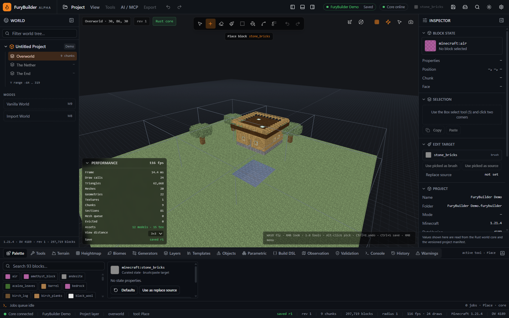

# FuryBuilder

FuryBuilder is an offline-first 3D studio for creating, inspecting, editing and exporting
Minecraft Java Edition worlds and structures. It is a desktop editor, not a game client:
human users work through the UI, and external AI agents work through the same
Application API over MCP.

- **Platform:** Windows first (Tauri 2 + WebView2), macOS/Linux later.
- **Target game versions:** Minecraft Java classic Anvil **1.18-1.21.11** (import, editing,
  project snapshots, same-version export and generation with the exact official server JAR,
  plus exact per-version client-JAR block/item catalogs).
- **Project modes:** `Empty Project`, `Flat base`, `Import World` (classic Java 1.18–1.21.11)
  and `Vanilla World` (official local generator for the project's exact version after explicit
  dependency setup) are available.
- **License:** Apache-2.0 for FuryBuilder code; see `LICENSE` and `NOTICE`. Minecraft game
  assets are **not** distributed with this repository; see `docs/legal/third-party-notices.md`.

## Demo



A self-authored demo project and a real WebView2 screenshot are in
[docs/demo](docs/demo/README.md). The project itself contains no Minecraft game files and
works without Minecraft or Java; the screenshot was rendered with the recorder's locally
installed 1.21.4 assets.

## Repository layout

```text
apps/desktop/          React + TypeScript + Vite UI and Tauri shell
crates/world-domain/   Block states, coordinates, chunks, sections, revisions
crates/world-operations/ Selection, fill/replace, transactions, undo/redo
crates/world-io/       Versioned NBT / structure / Anvil adapters
crates/world-generation/ Deterministic local terrain and object generators
crates/world-application/ Command/query API, projects, jobs, permissions
crates/project-store/  Versioned project folders, atomic snapshots, recovery
crates/mcp-bridge/     Local stdio MCP adapter (Rust, bundled sidecar)
docs/                  user guides, reference, formats, architecture, release
fixtures/              Small self-authored test structures (no Mojang assets)
```

## Requirements

For the packaged Windows beta, see [docs/reference.md](docs/reference.md).
In short: 64-bit Windows 10/11 with the WebView2 runtime; no Minecraft installation or Java
runtime is required for `Empty Project`, `Flat base`, `Import World` or structure exchange.
`Vanilla World` additionally needs the Java major from the selected version profile (17 for
1.18–1.19, 21 for newer releases) and that version's official Minecraft `server.jar`, provided
or downloaded only after explicit consent.

Building from source additionally needs:

- Node.js >= 26 and pnpm >= 10
- Rust stable (MSVC toolchain) and Visual Studio Build Tools
- WebView2 runtime (preinstalled on current Windows 10/11)

For a packaged Windows beta (install, update, uninstall), see
[docs/install-windows.md](docs/install-windows.md). The steps below are for development
from source.

## Development

```powershell
pnpm install
pnpm dev                                      # Vite dev server (browser UI, preview mode)
pnpm tauri:dev                                # Full desktop app (requires Rust + MSVC)
pnpm test                                     # TypeScript unit tests
pnpm typecheck                                # TypeScript strict check
pnpm lint
cargo test --workspace                        # Rust core tests
cargo clippy --workspace --all-targets -- -D warnings
```

A browser tab intentionally shows preview mode and never fakes backend data. Run the
desktop app to exercise the typed Tauri IPC (`app_info`, `ping`).

## Documentation

- [Getting started](docs/getting-started.md) - install, first project, editing, saving and
  structure export.
- [Advanced workflows](docs/advanced-workflow.md) - area editing, landscape tools, layers,
  templates, objects, Build DSL, observation, validation, MCP and performance.
- [MCP setup](docs/mcp-setup.md) - connect an AI client, access modes and confirmations.
- [Reference](docs/reference.md) - supported baseline, tested machine, feature dependencies
  and known limitations.
- [Formats](docs/formats.md) - supported versions, editable data, structure `.nbt`, world
  export and selection rules.
- [Architecture](docs/architecture.md) - system shape, decisions, security and dependency
  policy.
- [Release and data policy](docs/release.md) - versioning, changelog, installer, updates,
  backups and schema policy.
- [Documentation index](docs/README.md)

## Known limitations (Windows beta)

The supported baseline, tested machine and maintained limitation list are in
[docs/reference.md](docs/reference.md). The most important current boundaries:

- Windows-first beta; browser `pnpm dev` is preview only and cannot edit, save or serve MCP.
- Classic Anvil Java 1.18–1.21.11 is supported for import, block/biome editing, project
  snapshots, same-version export and generation with the exact official server JAR. Snapshots,
  split 26.1+, legacy worlds, Bedrock and custom dimensions are refused; a bare `.mca`/`region/`
  is not a complete world.
- Imported-world edits cover block states and 4x4x4 biomes. Derived data and block entities are
  preserved raw, not recalculated or synthesized; the UI has no `VanillaRebuild` switch.
- Structure interchange is Java `.nbt` only and refuses entities/block entities/unknown tags.
  A complete world-folder export exists in the verified backend path but has no one-click UI.
- Vanilla World needs the profile's Java major, the exact official server JAR and explicit EULA
  consent; parity checks cover an untouched revision-1 base's block states only.
- MCP is read-only by default, resets on restart, uses a local Windows named pipe and needs a
  visible viewport for screenshots.
- Autosave runs every 30 seconds; a damaged autosave is not recovered. The renderer's large-map
  envelope is machine-specific, and the tested hardware was one GTX 1060 plus software backends.
- The current evidence comes from internal harnesses and one Windows 11 reference machine. No
  external beta-user field data exists yet (KL-43); untested configurations are not supported
  just because the app opens.
