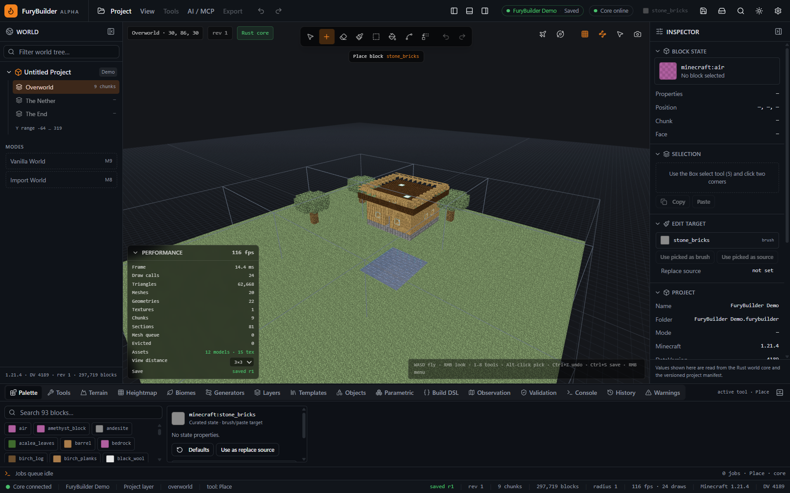
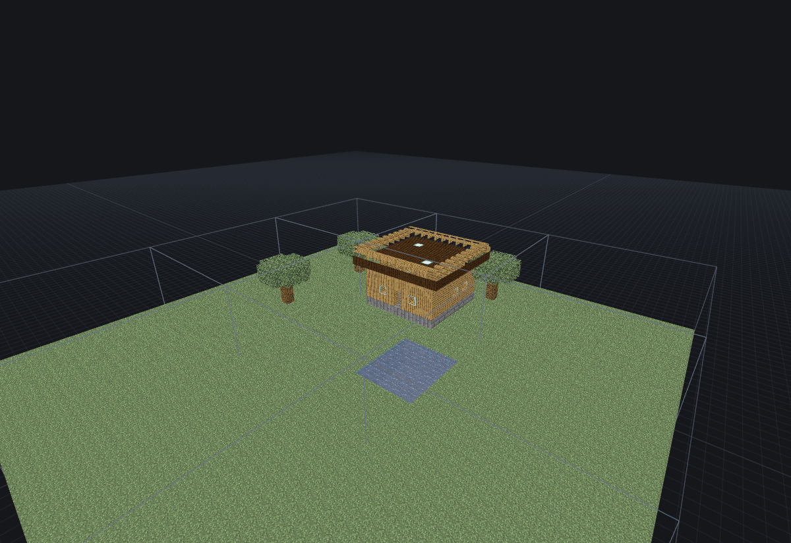
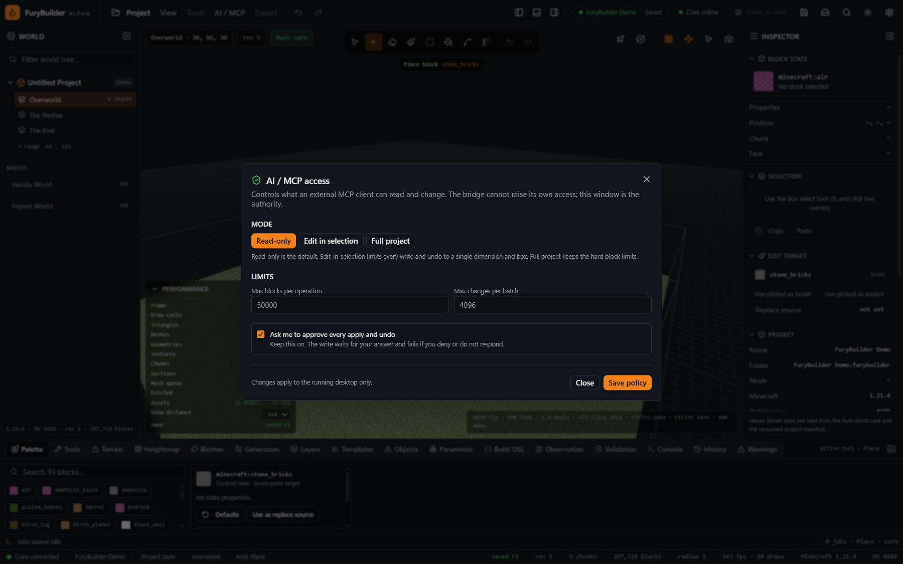
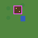

# Demo project and screenshots

This folder contains the release-facing demo material for the Windows beta:

- [`../../examples/furybuilder-demo.furybuilder`](../../examples/furybuilder-demo.furybuilder) —
  a real, self-contained FuryBuilder project that can be opened without Minecraft.
- [`screenshots/`](screenshots) — real WebView2/WebGL captures of that project.
- [`evidence.json`](evidence.json) — hashes, dimensions, world revision and environment for
  the screenshots, the project and the MCP probe.
- [`mcp-probe.json`](mcp-probe.json) — a real read-only stdio MCP probe against the same
  project: block, region, stale-revision rejection and a live viewport capture.

The repository does not include Minecraft game files. The demo project contains only a
FuryBuilder manifest, a deterministic block-state snapshot and an empty source manifest. The
screenshots were rendered on the recording machine with a legally installed Minecraft 1.21.4
client JAR and asset index (`12 models · 15 tex`). No Mojang JAR, texture or asset file is
copied into the project, this folder or any installer.

## What the demo shows

The scene is seeded by FuryBuilder's built-in `load_demo_world` command. It spans a 3×3 chunk
plateau (9 chunks, 81 sections, 297,719 blocks at revision 1) and contains:

- grass terrain over dirt and stone, with a small pond;
- a 9×9 oak house on a stone-brick floor, with glass windows, a stair-bordered dark-oak roof,
  torches and sea-lantern lights;
- three oak trees;
- no Minecraft world metadata, region files, entities or block entities.

It is deterministic demo content, **not a Minecraft world** and not evidence of vanilla
worldgen parity. It is an `Empty Project` that received the built-in scene; the manifest says
so explicitly.

## Screenshots



_The real desktop window at 1800×1125. The performance panel and status bar are part of the
application, not an overlay added for the screenshot._



_A clean 1200×825 viewport capture at world revision 1, camera position `[30, 86, 30]`, target
`[3, 68, -3]`. The viewport metadata records the same revision and a complete 3×3 chunk set._



_The default access policy: read-only, explicit limits and approval for writes. The bridge
cannot raise its own access._



_A deterministic top-down Observation map (48×48, one block per pixel, bounds
`-16..31 × 60..72 × -16..31`). The PNG and its metadata are produced by the Rust world core,
not by a screenshot of the viewport._

## Open the demo

1. Install FuryBuilder from the Windows beta package (or run the debug desktop build).
2. Copy the whole `furybuilder-demo.furybuilder` folder into the FuryBuilder projects
   directory, keeping the `.furybuilder` suffix:

   ```text
   %APPDATA%\com.furybuilder.desktop\projects\furybuilder-demo.furybuilder
   ```

3. Start (or restart) FuryBuilder and open the project from the Project manager. The display
   name is **FuryBuilder Demo**.
4. Fly or orbit around the scene, place a block, undo it, save, close and reopen. The project
   is a normal editable project; the demo does not add a special mode.

If you only want to inspect the 3D scene without creating the project manually, start the app
from a checkout and run the capture harness described below; it creates the same project in an
isolated temporary app-data directory.

## Use the demo with MCP

The demo is a good first target for the setup in [MCP setup](../mcp-setup.md):

1. Open the demo project and leave the access mode at **Read-only**.
2. Ask the client for `bridge_info`, `world_info`, `get_block` at `(0, 64, 0)` and
   `capture_viewport`.
3. Confirm that the tool responses report revision `1` and the same project ID.
4. Only after that, switch to **Edit in selection**, keep approval enabled, and apply one
   bounded operation. Return to read-only when finished.

[`mcp-probe.json`](mcp-probe.json) is the recorded result of a real stdio probe against this
project. It reports the modern protocol era, `minecraft:grass_block` at `(0, 64, 0)`, a
27-block region summary, a deliberate stale-revision rejection and a real viewport capture
whose metadata agrees with the world revision. The probe was written against the former
TypeScript bridge; the Rust bridge preserves the same tool contract and protocol surface.

## Reproduce the demo and screenshots

The capture script runs the actual debug Tauri app with an isolated app-data directory and
WebView2 profile. It creates the project through the real frontend store, saves the built-in
demo scene through the real project store, reloads it, and records the real window.

```powershell
# Terminal 1
pnpm dev

# Terminal 2
node scripts/demo-webview2.mjs <new-output-directory> <minecraft-launcher-root>
```

- `<new-output-directory>` must not exist yet.
- Pass `placeholder` instead of a launcher root to use FuryBuilder's original placeholder
  textures. The project data is identical; only the rendered pixels differ.
- The output contains `project/furybuilder-demo.furybuilder`, `screenshots/`, `evidence.json`
  and `mcp-probe.json`. Review it, then copy those files into this folder and `examples/`.
- The script refuses to copy a JAR, texture or any other Mojang asset into the output.

Run the committed checks without the desktop app:

```powershell
python scripts/test_demo_assets.py
cargo test -p furybuilder-project-store --test demo_project
```

## Honest limitations

- The project is deterministic demo content; it is not a Minecraft world and does not claim
  vanilla worldgen parity.
- The screenshots are real captures, but GPU anti-aliasing and driver differences mean they
  are not a per-pixel reference target. The viewport metadata records the revision, camera,
  resolution and renderer schema for reproducibility.
- The recording machine has one physical GPU (NVIDIA GTX 1060 3 GB); this is not multi-GPU or
  cross-vendor evidence.
- The observation map is bounded to the demo bounds and one block per pixel; it is not a
  full-world render.
- The screenshots use the recorder's local assets. A machine without Minecraft renders the
  same project and block data with original FuryBuilder placeholders; that fallback does not
  modify the world.
- This material is not a beta-user acceptance test and makes no signature, installer or
  Minecraft redistribution claim beyond the recorded evidence.
